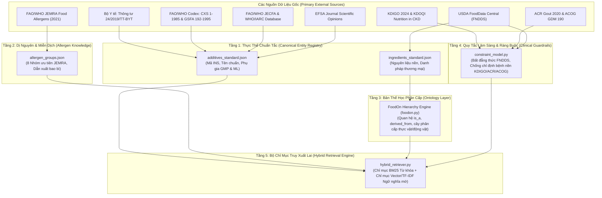

# BÁO CÁO MÔ TẢ QUY TRÌNH THỰC HIỆN 3 CẤU HÌNH TRONG HỆ THỐNG FOODHEALTHQA

> **Tài liệu Kỹ thuật & Thiết kế Kiến trúc Hệ thống**  
> **Đề tài:** Hệ thống hỏi đáp tư vấn an toàn thực phẩm cá nhân hóa từ thành phần bao bì  
> **Cơ chế suy luận & tổng hợp:** Mô hình Ngôn ngữ Lớn (Google Gemini hoặc Qwen2.5 chạy cục bộ qua Ollama, chọn được) kết hợp RAG Đa tầng  

> **Cập nhật 2026-11-11 — định hướng QA động.** Hệ thống chuyển từ "tìm tri thức theo thành phần của nhãn" sang "hiểu câu hỏi người dùng rồi tra cơ sở tri thức theo câu hỏi" (mục 4.5). Bộ QA benchmark chỉ còn là **bộ chấm** nằm ngoài luồng trả lời (mục 7.4), không còn là đầu vào của giao diện demo. Mục 10 liệt kê phần chưa làm.

> **Cập nhật 2026-11-12.** (1) Thêm truy xuất đoạn bằng chứng, gồm nhánh dense `bge-m3` tùy chọn (mục 4.6); (2) mô hình sinh câu trả lời chọn được giữa Gemini và Qwen2.5 qua Ollama (mục 2); (3) giao diện nhập liệu thay đổi theo từng cấu hình, phân biệt nhãn mẫu và đầu vào tự nhập (mục 3.3); (4) quy trình chạy theo lô có tiếp tục (resume), danh sách khóa Gemini và so sánh hai mô hình (mục 11).

---

## MỤC LỤC
1. [Tổng quan Đề tài & Bản chất của 3 Cấu hình Thử nghiệm](#1-tổng-quan-đề-tài--bản-chất-của-3-cấu-hình-thử-nghiệm)
2. [Vai trò của Mô hình Ngôn ngữ Lớn (LLM) trong Hệ thống](#2-vai-trò-của-mô-hình-ngôn-ngữ-lớn-llm-trong-hệ-thống)
3. [Bảng Ma trận So sánh 3 Cấu hình & Đặc tả Dữ liệu Đầu vào (Input Specification)](#3-bảng-ma-trận-so-sánh-3-cấu-hình--đặc-tả-dữ-liệu-đầu-vào-input-specification)
   - [3.1. Đặc tả Chi tiết Dữ liệu Đầu vào (Input Specifications)](#31-đặc-tả-chi-tiết-dữ-liệu-đầu-vào-input-specifications)
   - [3.2. Ma trận So sánh Tính năng 3 Cấu hình](#32-ma-trận-so-sánh-tính-năng-3-cấu-hình)
   - [3.3. Nguồn đầu vào: nhãn mẫu và đầu vào tự nhập](#33-nguồn-đầu-vào-nhãn-mẫu-và-đầu-vào-tự-nhập)
4. [Mô tả Chi tiết Quy trình Vận hành của Từng Cấu hình](#4-mô-tả-chi-tiết-quy-trình-vận-hành-của-từng-cấu-hình)
   - [4.1. Cấu hình A — Baseline LLM không truy xuất](#41-cấu-hình-a--baseline-llm-không-truy-xuất)
   - [4.2. Cấu hình B — RAG với đầu vào văn bản chuẩn](#42-cấu-hình-b--rag-với-đầu-vào-văn-bản-chuẩn)
   - [4.3. Cấu hình C — Pipeline đầu cuối từ ảnh](#43-cấu-hình-c--pipeline-đầu-cuối-từ-ảnh)
   - [4.4. Bảng Đối chiếu Chi tiết 10 Bước Xử lý Xuyên suốt 3 Cấu hình](#44-bảng-đối-chiếu-chi-tiết-10-bước-xử-lý-xuyên-suốt-3-cấu-hình)
   - [4.5. Tầng QA Động (Dynamic QA)](#45-tầng-qa-động-dynamic-qa)
   - [4.6. Truy xuất đoạn bằng chứng (Passage Retrieval)](#46-truy-xuất-đoạn-bằng-chứng-passage-retrieval)
5. [Ý nghĩa của Khâu Đóng gói Chỉ thị (Prompting) trong Đề tài](#5-ý-nghĩa-của-khâu-đóng-gói-chỉ-thị-prompting-trong-đề-tài)
6. [Hệ thống Đo lường & Các Chỉ số Đánh giá Khoa học](#6-hệ-thống-đo-lường--các-chỉ-số-đánh-giá-khoa-học)
7. [Thiết kế Bộ Dữ liệu QA Benchmark](#7-thiết-kế-bộ-dữ-liệu-qa-benchmark)
   - [7.4. Quy tắc sử dụng bộ QA trong hướng QA động](#74-quy-tắc-sử-dụng-bộ-qa-trong-hướng-qa-động)
8. [Danh Mục Chi Tiết Các Nguồn Pháp Lý & Y Văn Quốc Tế Của Bộ QA Benchmark](#8-danh-mục-chi-tiết-các-nguồn-pháp-lý--y-văn-quốc-tế-của-bộ-qa-benchmark)
9. [Kiến Trúc & Phương Thức Tổ Chức Cơ Sở Tri Thức Đa Nguồn (Knowledge Base Architecture)](#9-kiến-trúc--phương-thức-tổ-chức-cơ-sở-tri-thức-đa-nguồn-knowledge-base-architecture)
   - [9.1. Sơ đồ Kiến trúc Phân tầng Tri thức (5-Tier KB Architecture)](#91-sơ-đồ-kiến-trúc-phân-tầng-tri-thức-5-tier-kb-architecture)
   - [9.2. Cấu trúc Schema Dữ liệu Chuẩn hóa (JSON Data Models)](#92-cấu-trúc-schema-dữ-liệu-chuẩn-hóa-json-data-models)
   - [9.3. Phương thức Hợp nhất Đa nguồn (Multi-Source Ingestion & Identity Linking)](#93-phương-thức-hợp-nhất-đa-nguồn-multi-source-ingestion--identity-linking)
   - [9.4. Cơ chế Chỉ mục & Truy xuất Lai Đa Tác tử (Hybrid Multi-Agent Retrieval)](#94-cơ-chế-chỉ-mục--truy-xuất-lai-đa-tác-tử-hybrid-multi-agent-retrieval)
10. [Hạn chế hiện tại & Hướng phát triển](#10-hạn-chế-hiện-tại--hướng-phát-triển)
11. [Vận hành thí nghiệm: chạy theo lô, tiếp tục và so sánh hai mô hình](#11-vận-hành-thí-nghiệm-chạy-theo-lô-tiếp-tục-và-so-sánh-hai-mô-hình)

---

## 1. Tổng quan Đề tài & Bản chất của 3 Cấu hình Thử nghiệm

Hệ thống **FoodHealthQA** giải quyết bài toán: Nhận diện thành phần thực phẩm từ ảnh chụp bao bì, chuẩn hóa thực thể và đối chiếu với kho tri thức y tế/pháp lý (mã INS/E-number, ngưỡng an toàn độc học JECFA ADI, quy định Thông tư 24/2019/TT-BYT, tiêu chuẩn quốc tế Codex STAN 192-1995, cảnh báo dị ứng, hồ sơ dinh dưỡng định lượng USDA FNDDS, và lịch sử sự cố an toàn thực phẩm). Cuối cùng, hệ thống kích hoạt chốt chặn an toàn (Guardrail) và điều khiển mô hình ngôn ngữ lớn (LLM) sinh câu trả lời tư vấn cá nhân hóa có trích dẫn nguồn xác thực.

Để đánh giá khoa học và khách quan tính hiệu quả của từng mắt xích trong chuỗi xử lý, hệ thống thiết lập **3 cấu hình thử nghiệm đối chứng (Ablation Study)**:

* **Cấu hình A — Baseline LLM không truy xuất:** Mô hình trả lời dựa vào tri thức nén sẵn bên trong mạng nơ-ron. Hệ thống cung cấp câu hỏi, hồ sơ bệnh lý (persona) và chuỗi thành phần (`ingredient_text`) nhưng **không kích hoạt bất kỳ cơ chế tra cứu KB hay luật an toàn nào**. Cấu hình này giúp đo lường mức độ rủi ro, nguy cơ bịa đặt thông tin (hallucination) và khả năng phán đoán tự thân của AI khi không có hệ thống hỗ trợ.
* **Cấu hình B — RAG với đầu vào văn bản tham chiếu:** Hệ thống nhận đầu vào từ dữ liệu nhãn đã bóc tách, bỏ qua lỗi OCR, sau đó kích hoạt tra cứu và guardrail. Văn bản benchmark hiện hành chưa được xác nhận là chính xác 100% bởi chuyên gia; kết quả phản ánh thử nghiệm nội bộ, không phải hiệu năng trên dữ liệu gold đã xác thực.
* **Cấu hình C — Pipeline đầu cuối từ ảnh (OCR + RAG + LLM):** Đại diện cho **Hệ thống Triển khai Thực tế**. Ảnh đi qua PaddleOCR DBNet + VietOCR, sau đó chuẩn hóa từ vựng bằng từ điển miền thực phẩm, liên kết thực thể, tra cứu tri thức và chốt chặn an toàn. **Gemini không sửa chính tả OCR trong thí nghiệm chính.** So sánh C với B đo đúng sự lan truyền sai số OCR vì hai cấu hình gọi cùng một hàm downstream từ normalization trở đi.

### Định hướng hiện tại: RAG có chốt chặn luật, theo hướng QA động

Hệ thống đi theo năm nguyên tắc:

1. **RAG nhiều nguồn có guardrail y tế.** Tri thức đến từ cơ sở tri thức (KB) gồm TT24, Codex, JECFA, EFSA, dị nguyên, sự cố thực phẩm, USDA FNDDS, OpenFoodFacts và hồ sơ persona. Không có tri thức nào đến từ bộ QA benchmark.
2. **Luật quyết định an toàn, LLM chỉ diễn đạt** (mục 2). Khi bằng chứng không đủ, hệ thống từ chối có lý do thay vì để LLM suy đoán.
3. **QA động.** Câu hỏi của người dùng quyết định hệ thống tra cứu gì: hiểu ý định, nhận diện phụ gia/dị nguyên/chất dinh dưỡng được hỏi, tra KB theo đó, ghi vết nguồn đã tra, và nói rõ chỗ nào CSDL chưa có thông tin (mục 4.5).
4. **Ablation làm nền thực nghiệm.** Ba cấu hình A/B/C vẫn là khung so sánh; tầng QA động dùng chung cho B và C, không áp dụng cho A.
5. **Bộ QA là bộ chấm**, không phải đầu vào của luồng trả lời (mục 7.4). Trên giao diện demo, người dùng tự gõ câu hỏi và chọn hồ sơ sức khỏe.

Hai luồng hoạt động tách biệt:

```
 Luồng 1 — Người dùng thật (không so sánh với đáp án chuẩn)
   Câu hỏi + persona (+ ảnh/nhãn) ──► A / B / C ──► câu trả lời + nhãn + trích dẫn + vết tra cứu
                                         ▲
                                   Cơ sở tri thức (KB)

 Luồng 2 — Chấm điểm hệ thống (chạy script, ngoài giao diện)
   Bộ QA: câu hỏi ──► A / B / C ──► dự đoán ──┐
   Bộ QA: đáp án + nhãn chuẩn ─────────────────┴──► so sánh ──► chỉ số A / B / C
```

### Hợp đồng thực nghiệm bắt buộc

* **A:** Văn bản nhãn tham chiếu + persona theo `persona_id` + câu hỏi → LLM-only. Không OCR, retrieval hay guardrail.
* **B:** Văn bản nhãn tham chiếu → parse/normalization → retrieval đa nguồn → guardrail/abstention → grounded answer → citation validation.
* **C:** Ảnh → PaddleOCR DBNet + VietOCR → lexical normalization → sau đó gọi **đúng cùng downstream của B**.
* B và C chỉ được khác nhau trước điểm vào `run_grounded_pipeline`; B dùng `S_perception = 1.0`, C dùng confidence OCR thật.
* Prediction không được nhận `reference_answer`, `gold_safety_label`, `source_ids` hay `source_citations` từ bản ghi tham chiếu.
* Kết quả thiếu mẫu, có lỗi sinh đáp án hoặc không có `evaluation_type=real` không được xuất bản trên dashboard chính.
* Tầng QA động (`modules/dynamic_qa.py`) chỉ đọc câu hỏi, persona, nhãn và KB. Không được đọc bộ QA benchmark hay đáp án chuẩn (có test kiểm tra: `test_dynamic_qa_never_reads_benchmark`).

---

## 2. Vai trò của Mô hình Ngôn ngữ Lớn (LLM) trong Hệ thống

Hệ thống hỗ trợ hai nhà cung cấp mô hình ngôn ngữ lớn, chọn bằng ô *Mô hình sinh câu trả lời* trên giao diện, biến môi trường `LLM_PROVIDER` hoặc tham số `--llm-provider`:

* **Gemini** (API của Google, mặc định): có chuỗi model dự phòng và hỗ trợ danh sách nhiều khóa API (mục 11).
* **Qwen2.5 chạy cục bộ qua Ollama** (biến `OLLAMA_MODEL`, mặc định `qwen2.5:latest`): không cần khóa API, không bị giới hạn hạn mức.

Cả ba cấu hình dùng chung một điểm gọi LLM (`_call_llm` trong `modules/pipeline.py`), nên so sánh giữa hai nhà cung cấp là công bằng. Mô hình nhỏ chạy cục bộ hay bỏ sót mã trích dẫn `[MÃ_NGUỒN]`; khi đó hệ thống gọi lại đúng một lần kèm lời nhắc, và không tự chèn nguồn thay cho mô hình. Thay vì để mô hình đóng vai trò quyết định toàn bộ, hệ thống phân định rõ ràng ranh giới chức năng:

1. **Khâu Thẩm định & Logic An toàn (Do Hệ thống RAG & Guardrail đảm nhiệm):** 
   Việc kiểm tra xem một chất có vượt ngưỡng ADI hay không, có gây sốc phản vệ cho người dị ứng hay không, hoặc có vi phạm quy định của Bộ Y tế hay không hoàn toàn do các thuật toán đối soát dữ liệu và mô hình ràng buộc y khoa thực hiện.
2. **Khâu Tổng hợp & Giao tiếp (Do LLM đảm nhiệm):** 
   LLM đóng vai trò công cụ tổng hợp thông tin, không phải bác sĩ hay người đưa ra chẩn đoán:
   * Tiếp nhận các kết luận y khoa, chứng cứ pháp lý và dữ liệu dinh dưỡng do hệ thống cung cấp.
   * Chuyển hóa các bảng mã số phức tạp thành ngôn ngữ tự nhiên tiếng Việt; nội dung vẫn cần được giới hạn trong bằng chứng truy xuất được và không thay thế tư vấn chuyên môn.
   * Gắn đúng mã trích dẫn nguồn đối chứng ở từng nhận định, tuyệt đối không suy diễn thêm các tuyên bố y khoa ngoài bằng chứng.

---

## 3. Bảng Ma trận So sánh 3 Cấu hình & Đặc tả Dữ liệu Đầu vào (Input Specification)

### 3.1. Đặc tả Chi Tiết Dữ Liệu Đầu Vào (Input Specifications) của 3 Cấu hình

Để bảo đảm tính khoa học nghiêm ngặt của nghiên cứu thực nghiệm (Ablation Study), dữ liệu đầu vào (Input) của từng cấu hình được phân định ranh giới rõ ràng:

| Thành phần Dữ liệu Đầu vào | Cấu hình A (Baseline LLM không truy xuất) | Cấu hình B (RAG + văn bản tham chiếu) | Cấu hình C (Pipeline đầu cuối từ ảnh) |
| :--- | :--- | :--- | :--- |
| **1. Ảnh bao bì thực phẩm (`product_image`)** | ❌ **KHÔNG CÓ** (Bỏ qua hoàn toàn dữ liệu ảnh) | ❌ **KHÔNG CÓ** (Không sử dụng ảnh để loại bỏ sai số quét) | ✅ **CÓ BẮT BUỘC**: File ảnh thực tế chụp từ camera điện thoại (PNG/JPG; có góc nghiêng, bóng sáng, cong nhăn, độ phân giải thay đổi). |
| **2. Chuỗi ký tự thành phần (`ingredient_text`)** | ✅ **CÓ** (Cung cấp chuỗi thành phần tham chiếu để LLM xử lý, nhưng không kích hoạt tra cứu KB) | ✅ **CÓ** (dùng annotation/văn bản tham chiếu có sẵn; chưa xác minh độc lập độ chính xác 100%) | ⚠️ **DỮ LIỆU TỰ SINH**: PaddleOCR DBNet phát hiện vùng chữ, VietOCR nhận dạng; sau đó lexical normalizer chuẩn hóa từ vựng/mã INS. |
| **3. Điểm số tự tin quang học ($S_{ocr}$)** | ❌ Không áp dụng ($N/A$) | Không chạy OCR; nếu đặt $S_{ocr}=1.0$ thì đó chỉ là giả định đầu vào, không phải xác nhận văn bản đúng | 🟡 Đo lường thực tế từ OCR ($S_{ocr} \in [0.80, 0.95]$). |
| **4. Câu hỏi của người dùng (`question`)** | ✅ **CÓ**: Câu hỏi truy vấn ngôn ngữ tự nhiên (ví dụ: *"Người suy thận mạn giai đoạn 3 có uống được sản phẩm này không?"*). | ✅ **CÓ**: Câu hỏi truy vấn tương tự (giữ nguyên để đảm bảo tính so sánh tương quan). | ✅ **CÓ**: Câu hỏi truy vấn tương tự. |
| **5. Hồ sơ lâm sàng người dùng (`persona_profile`)** | ✅ **CÓ**: Mã bệnh lý và tình trạng sinh lý (`diabetes_type_2`, `hypertension`, `ckd_stage_3`, `pregnancy_24w`, `soy_allergy`). | ✅ **CÓ**: Mã bệnh lý tương tự. | ✅ **CÓ**: Mã bệnh lý tương tự. |
| **6. Kho dữ liệu tra cứu KB & Luật An toàn** | ❌ **BỊ CÔ LẬP HOÀN TOÀN** (LLM không được cấp tri thức tra cứu, phải tự đoán mù). | ✅ **CẤP ĐẦY ĐỦ**: Đưa toàn bộ tài liệu tra cứu từ KB, Thông tư 24, JECFA, Codex, EFSA vào prompt. | ✅ **CẤP ĐẦY ĐỦ**: Tra cứu tri thức dựa trên các thực thể đã được liên kết sau khâu OCR. |

### 3.2. Ma trận So sánh Tính năng 3 Cấu hình

| Tiêu chí So sánh | Cấu hình A (LLM-Only) | Cấu hình B (Reference Text + RAG) | Cấu hình C (OCR + RAG + LLM) |
| :--- | :--- | :--- | :--- |
| **Bản chất kỹ thuật** | Closed-book QA (Không RAG) | Open-book RAG (văn bản tham chiếu, không OCR) | Full End-to-End Pipeline (Ảnh/OCR) |
| **Độ tự tin quang học ($S_{ocr}$)** | Không áp dụng ($N/A$) | Không đo OCR; không suy ra tính đúng của annotation | Bị suy giảm ($0.80 - 0.95$) |
| **Hậu xử lý chính tả** | Bỏ qua | Không chạy OCR correction | Từ điển/rule-based (`post_process_ocr_spelling`), không dùng Gemini |
| **Entity Linking** | Bỏ qua | Liên kết theo văn bản tham chiếu; kết quả cần được kiểm tra | HybridRetriever 4 tác tử (BM25 + TF-IDF) |
| **Tra cứu Đa nguồn Tri thức** | Bỏ qua hoàn toàn | Đầy đủ (KB, FNDDS, Hazard, OFF) | Đầy đủ (Dựa trên thực thể linked từ OCR) |
| **Kiểm định Guardrail** | Không có | Chạy luật trên đầu vào tham chiếu, không bảo đảm luật đúng | Chạy luật + Rủi ro sai số OCR |
| **Cơ chế từ chối (Abstention)**| Không có | Kích hoạt khi KB coverage thấp hoặc ADI thiếu dữ liệu | Tự động kích hoạt khi $S_{total} < \tau$ hoặc KB coverage thấp |
| **Cấu trúc Prompt** | Zero-evidence (Chỉ hỏi + Persona) | Strict Grounded (Evidence + Nguồn KB) | Strict Grounded (Evidence + Nguồn KB) |
| **Xác thực Trích dẫn** | Không có mã trích dẫn | Bắt buộc kiểm tra `[KB:...]` | Bắt buộc kiểm tra `[KB:...]` |
| **Ý nghĩa Nghiên cứu** | **Baseline — đo rủi ro LLM thuần** | **So sánh RAG trên văn bản tham chiếu** | **Đo pipeline trên ảnh/OCR** |

### 3.3. Nguồn đầu vào: nhãn mẫu và đầu vào tự nhập

Hệ thống có hai loại đầu vào, phục vụ hai mục đích khác nhau:

* **Nhãn mẫu:** ảnh bao bì có sẵn trong đề tài (493 ảnh có annotation). Mỗi ảnh có phần chữ thành phần do người đọc và chép lại, đi kèm bộ câu hỏi và đáp án chuẩn dùng để chấm điểm.
* **Đầu vào tự nhập:** người dùng tự gõ danh sách thành phần (Cấu hình A, B) hoặc tự tải một ảnh bất kỳ (Cấu hình C). Loại này không có đáp án chuẩn.

| Cấu hình | Dùng nhãn mẫu để | Dùng đầu vào tự nhập để |
| :--- | :--- | :--- |
| **A** (LLM không truy xuất) | Làm mốc so sánh chính thức: mô hình nhận văn bản thành phần chuẩn và trả lời hoàn toàn từ kiến thức nền. | Quan sát cách LLM thuần xử lý một danh sách thành phần bất kỳ, đặc biệt các trường hợp trả lời thiếu căn cứ. |
| **B** (văn bản chuẩn + RAG) | Đối chứng chính thức. Không có lỗi OCR nên B là cận trên của C. A so với B đo giá trị của RAG; B so với C đo tác động của OCR và chuẩn hóa. | Thử độ bền của chuẩn hóa thực thể: cố ý gõ sai chính tả hoặc méo mã INS để quan sát khả năng phục hồi. Chỉ mang tính minh họa. |
| **C** (ảnh + OCR + RAG) | Pipeline đầy đủ trên cùng sản phẩm với A và B, để quy sai khác về đúng nguyên nhân. | Mô phỏng người dùng chụp một nhãn chưa từng thấy; đánh giá định tính khả năng khái quát hóa, không tính điểm. |

**Nguyên tắc kiểm soát biến.** Phép so sánh chỉ có giá trị khi các cấu hình nhận cùng đầu vào: cùng sản phẩm, cùng câu hỏi, cùng hồ sơ người dùng. A và B nhận văn bản annotation, C nhận chính ảnh của sản phẩm đó. Đầu vào tự nhập không có ảnh đối chiếu cho C nên không thuộc phép so sánh ablation.

**Phân tách số liệu và minh họa.** Các chỉ số chỉ được tính từ các lần chạy hàng loạt trên benchmark có đáp án chuẩn (mục 11). Giao diện demo dùng cho minh họa định tính. Câu hỏi trên giao diện do người dùng tự gõ, không lấy từ bộ câu hỏi benchmark, để tránh trùng với dữ liệu chấm điểm.

**Giao diện theo từng cấu hình** (`app.py`, tab *Trải Nghiệm Demo*): ô chọn cấu hình nằm đầu tiên và các khung bên dưới đổi theo cấu hình.

| Cấu hình | Khung nhập bên trái | Hiển thị ảnh | Các tab kết quả |
| :--- | :--- | :---: | :--- |
| **A** | Chọn nhãn mẫu (kèm ô văn bản annotation, sửa được) hoặc tự nhập văn bản | Không | Câu trả lời LLM · Dữ liệu đầu vào |
| **B** | Giống A | Không | Guardrail · Chuẩn hóa thực thể · Văn bản đầu vào · Data Hub |
| **C** | Chọn ảnh mẫu hoặc tải ảnh lên | Có | Guardrail · Chuẩn hóa thực thể · OCR & phục hồi chính tả · Data Hub |

Ở chế độ tự nhập của A và B, giao diện hiển thị ghi chú: kết quả chỉ để thử nghiệm, không thuộc phép so sánh A–B–C.

**Chế độ so sánh A/B/C** (công tắc *So sánh A / B / C trên cùng một đầu vào* ở tab Trải Nghiệm Demo; mã: `modules/compare_runner.py`, `modules/compare_ui.py`). Cùng một nhãn mẫu và một câu hỏi được chạy lần lượt qua A, B, C; có thể chọn một hoặc cả hai mô hình (Gemini, Qwen2.5) để so sánh thêm giữa hai nhà cung cấp. Kết quả hiển thị theo lưới mô hình × cấu hình, mỗi ô gồm nhãn an toàn, số nguồn trích dẫn, số đoạn truy xuất, thời gian và câu trả lời; bên dưới là bảng so sánh nhanh, các nhận xét gắn với câu hỏi nghiên cứu (A→B: giá trị của RAG; B→C: ảnh hưởng của OCR; Gemini so với Qwen2.5) và phần đối chiếu văn bản chuẩn với văn bản OCR. OCR chỉ chạy một lần và dùng chung cho mọi mô hình. Độ khớp OCR là tỷ lệ ký tự của mục thành phần (văn bản chuẩn) được OCR đọc đúng; vì OCR đọc cả mặt bao bì, chỉ đoạn "Thành phần" khớp nhất được đem so. Với văn bản tự nhập không có ảnh, cột C bị bỏ qua. Đây là minh họa định tính, không tính điểm.

---

## 4. Mô tả Chi tiết Quy trình Vận hành của Từng Cấu hình

```
[Ảnh nhãn / Text thành phần + Câu hỏi + Hồ sơ lâm sàng Persona]
                              │
       ┌───────────────────┼───────────────────┐
       ▼                   ▼                   ▼
 [ CẤU HÌNH A ]      [ CẤU HÌNH B ]      [ CẤU HÌNH C ]
 (Baseline LLM)       (RAG + Text tham chiếu) (Pipeline từ ảnh)
       │                   │                   │
  Bỏ qua OCR/KB     Nạp văn bản tham chiếu PaddleOCR DBNet + VietOCR
       │            (Không OCR; chưa xác minh) (Có nhiễu ảnh, conf thấp)
       │                   │                   │
  Bỏ qua Linking    Entity Linking chuẩn  Hậu xử lý chính tả Post-OCR
       │                   │                   │
  Bỏ qua Guardrail  Tra cứu KB + Luật     HybridRetriever (BM25+TF-IDF)
       │                   │                   │
       │            Guardrail An toàn     Tra cứu KB + Guardrail An toàn
       │                   │              (Tính rủi ro sai số OCR)
       │                   │                   │
 Prompt Không Evidence  Prompt Đầy đủ Evidence Prompt Đầy đủ Evidence
  (Chỉ hỏi + Persona) (Evidence + Nguồn KB) (Evidence + Nguồn KB)
       │                   │                   │
       └───────────────────┼───────────────────┘
                              ▼
               [ Gọi LLM: Gemini / Qwen2.5 ]
                              │
                              ▼
             [ Hậu kiểm Trích dẫn & Tách nhãn an toàn ]
                              │
                              ▼
          [ Xuất file kết quả đánh giá: predictions_config_X.jsonl ]
```

---

### 4.1. Cấu hình A — Baseline LLM không truy xuất

* **Ý nghĩa:** Đo lường xem nếu chỉ dựa vào dữ liệu học sẵn của mô hình ngôn ngữ thì câu trả lời có đủ an toàn cho người bệnh hay không.

#### Quy trình 4 bước thực hiện:
1. **Bước 1: Tiếp nhận Yêu cầu & Nhận diện Hồ sơ Bệnh lý**
   * Hệ thống tiếp nhận câu hỏi của người dùng và bối cảnh sức khỏe.
   * Quá trình phân tích ngữ cảnh sẽ trích xuất hồ sơ bệnh lý đặc thù của người dùng (ví dụ: người mắc bệnh suy thận mạn tính, đái tháo đường týp 2, phụ nữ trong thai kỳ, trẻ nhỏ 5 tuổi, hoặc người có tiền sử dị ứng đậu nành).
2. **Bước 2: Cung cấp Thành phần & Cô lập Tri thức (Bỏ qua hoàn toàn khâu RAG)**
   * Hệ thống cung cấp chuỗi thành phần (`ingredient_text`) cho LLM để đảm bảo so sánh công bằng (LLM biết sản phẩm chứa gì), nhưng **cố tình không kết nối với bất kỳ cơ sở dữ liệu nào**: không liên kết thực thể và không tra cứu các tiêu chuẩn an toàn thực phẩm.
3. **Bước 3: Đóng gói Yêu cầu Suy đoán Tự do**
   * Hệ thống thiết lập một bản chỉ thị mang tính "đóng sách":
     * Cung cấp chuỗi thành phần, thông tin bệnh lý của người dùng cùng câu hỏi cần giải đáp.
     * **Không cung cấp cơ sở dữ liệu tham chiếu** — buộc mô hình phải tự huy động trí nhớ tiền huấn luyện để đưa ra lời khuyên.
     * Yêu cầu LLM sử dụng ngôn ngữ khuyến nghị (không phải kết luận y khoa) và tự gán nhãn mức độ an toàn vào dòng cuối.
4. **Bước 4: Sinh Câu trả lời & Tách Nhãn An toàn**
   * Mô hình ngôn ngữ (Gemini hoặc Qwen2.5) xử lý với nhiệt độ thấp để giảm tính ngẫu nhiên.
   * Hệ thống bóc tách nhãn mức độ an toàn được mô hình tự kết luận (như An toàn, Cảnh báo, hoặc Nguy hiểm) và lưu vào tệp dữ liệu kết quả để phục vụ chấm điểm.
* **Hạn chế:** Mô hình thường trả lời chung chung mang tính ngoại giao, không có căn cứ pháp lý, không trích dẫn được điều luật và có xu hướng đoán nhãn "An toàn" một cách chủ quan, gây rủi ro lớn trong y tế.

---

### 4.2. Cấu hình B — RAG với đầu vào văn bản chuẩn

* **Ý nghĩa:** Đánh giá năng lực của toàn bộ hệ thống tri thức và luật an toàn khi loại bỏ hoàn toàn các lỗi sai sót do việc quét chữ từ bao bì gây ra.

#### Quy trình 6 bước thực hiện:
1. **Bước 1: Tiếp nhận Văn bản Thành phần Tham chiếu**
   * Thay vì dùng camera đọc ảnh, hệ thống nạp trực tiếp danh sách thành phần đã được kiểm định chính xác tuyệt đối từ bộ dữ liệu chuẩn (văn bản sạch, không mất dấu, không lỗi chính tả).
2. **Bước 2: Phân tách & Ánh xạ Thực thể Chuẩn tắc**
   * Hệ thống phân rã đoạn văn bản thành các thành phần và phụ gia đơn lẻ.
   * Tiến hành đối chiếu trực tiếp từng chất với Cơ sở Tri thức Phụ gia chuẩn để định danh chính xác mã số quốc tế (INS/E-number) và tên khoa học.
3. **Bước 3: Tra cứu Đa nguồn Tri thức Chuyên sâu**
   * Hệ thống đồng thời trích xuất các bằng chứng khoa học vững chắc:
     * **Liều lượng chấp nhận:** Ngưỡng nạp hàng ngày an toàn từ Ủy ban Chuyên gia hỗn hợp FAO/WHO về Phụ gia Thực phẩm (JECFA ADI).
     * **Quy chuẩn pháp lý:** Bảng danh mục cho phép và giới hạn tối đa theo Thông tư 24/2019/TT-BYT và tiêu chuẩn Codex Quốc tế.
     * **Cảnh báo nguy cơ:** Các phát hiện khoa học độc tính mới nhất từ Cơ quan An toàn Thực phẩm Châu Âu (EFSA).
4. **Bước 4: Đánh giá Ràng buộc Phủ định & Chống chỉ định Y khoa**
   * Chạy mô hình kiểm định an toàn đối chiếu giữa các chất đã nhận diện với hồ sơ bệnh lý người dùng:
     * Phát hiện các xung đột y khoa (ví dụ: người bệnh Phenylketon niệu không được dùng chất tạo ngọt Aspartame; người tăng huyết áp cần kiểm soát lượng muối có trong bột ngọt và bột nở).
     * Rà soát 9 nhóm dị nguyên phổ biến (sữa, trứng, đậu nành, lúa mì, hải sản...) và các dẫn xuất chuyển hóa.
5. **Bước 5: Đóng gói Ngữ cảnh Bằng chứng Nghiêm ngặt**
   * Thiết lập bản chỉ thị cho LLM theo nguyên tắc "mở sách":
     * Đưa toàn bộ các đoạn bằng chứng đã xác thực ở Bước 3 và Bước 4 vào làm tài liệu học tập duy nhất cho câu trả lời.
     * Cung cấp danh sách các mã định danh tài liệu được phép trích dẫn.
     * Ra quy định bắt buộc: Mọi câu khẳng định y khoa phải đi kèm trích dẫn nguồn trong ngoặc vuông; không được thêm thắt thông tin nằm ngoài bằng chứng.
6. **Bước 6: Khởi tạo Lời tư vấn & Xác thực Trích dẫn**
   * Mô hình ngôn ngữ (Gemini hoặc Qwen2.5) tiếp nhận khối tri thức, tổng hợp thành lời khuyên mạch lạc.
   * Hệ thống kích hoạt thuật toán hậu kiểm trích dẫn để xác minh: Mọi trích dẫn trong ngoặc vuông có thực sự tồn tại trong danh mục nguồn được phép hay không. Sau đó lưu lại câu trả lời và nhãn an toàn đã thẩm định.

---

### 4.3. Cấu hình C — Pipeline đầu cuối từ ảnh

* **Ý nghĩa:** Đây là mô hình hoạt động đầy đủ trong đời thực của ứng dụng khi người dùng chụp ảnh sản phẩm từ điện thoại di động. Cấu hình này giúp đo lường mức độ ảnh hưởng của lỗi đọc chữ đối với chất lượng tư vấn y khoa.

#### Quy trình 7 bước thực hiện:
1. **Bước 1: Thu nhận Quang học & Trích xuất Ký tự từ Ảnh Bao bì**
   * PaddleOCR DBNet phát hiện/cắt vùng chữ; VietOCR VGG-Transformer nhận dạng tiếng Việt. PaddleOCR recognition multi-pass là fallback.
   * Do đặc thù bề mặt bao bì bị bóng, cong hoặc chữ quá nhỏ, hệ thống thu nhận chuỗi văn bản thô kèm theo điểm số độ tin cậy nhận dạng (đo lường mức độ rõ nét của ảnh).
2. **Bước 2: Phục hồi Ngữ nghĩa & Chuẩn hóa Chính tả Sau OCR**
   * Chuỗi chữ thô được đưa qua thuật toán phục hồi chính tả chuyên ngành thực phẩm:
     * Khôi phục các thanh dấu tiếng Việt bị mờ nhạt (ví dụ: phân biệt "dầu" và "đậu", "bơ" và "bò").
     * Hiệu chỉnh các lỗi nhầm lẫn quang học kinh điển trong mã số phụ gia (như chữ `O` bị quét nhầm thành số `0`, hoặc chuỗi `INS 50O` được tự động chuyển thành `INS 500`).
3. **Bước 3: Chuẩn hóa Thực thể Đa tác tử Dưới điều kiện Bất định**
   * Vì chữ quét được có thể vẫn còn khiếm khuyết, hệ thống kích hoạt cơ chế 4 tác tử thông minh:
     * **Tác tử Truy xuất lai:** Tìm kiếm kết hợp theo cả 2 hướng: trùng khớp từ khóa bề mặt (BM25) và tương đồng ngữ nghĩa mờ trong không gian vector (TF-IDF/SBERT) để không bỏ sót các dạng viết tắt hoặc tên thương mại.
     * **Tác tử Chọn lọc:** Ưu tiên mã số chính thức và các khái niệm cụ thể.
     * **Tác tử Đánh giá:** Chấm điểm mức độ tương đồng bản chất hóa học giữa từ quét được và thực thể chuẩn.
     * **Tác tử Sinh từ đồng nghĩa:** Nếu độ tương đồng còn thấp, tác tử sẽ tự động mở rộng các dạng danh pháp khác dựa trên cây phả hệ Bản thể học Thực phẩm (FoodOn) để tìm kiếm lượt hai.
4. **Bước 4: Tra cứu Đa nguồn & Tính toán Ràng buộc Số học**
   * Đối soát thực thể với kho quy chuẩn an toàn, bảng liều lượng chấp nhận ADI và hệ thống cảnh báo sự cố thực phẩm toàn cầu (phát hiện các lô hàng từng bị thu hồi do nhiễm khuẩn hoặc dị nguyên ẩn).
   * Tích hợp dữ liệu dinh dưỡng định lượng USDA FNDDS: Chuyển đổi các giá trị dinh dưỡng thành hàm chỉ thị khoảng để kiểm tra xem lượng Natri, Calo, Đường trên khẩu phần có vượt quá ngưỡng cho phép của bệnh nhân hay không.
5. **Bước 5: Chốt chặn An toàn & Kích hoạt Cơ chế Từ chối Thông minh**
   * Hệ thống tổng hợp điểm tin cậy kép:
     $$\text{Độ tin cậy Tổng thể} = \text{Độ rõ nét của Ảnh OCR} \times \text{Độ chắc chắn khi Liên kết Thực thể}$$
   * **Cơ chế Từ chối có Nguyên tắc (Principled Abstention):** hệ thống từ chối kết luận (`ABSTAIN`) trong đúng hai trường hợp, mỗi trường hợp có lời khuyên riêng (mã: `modules/abstention.py`, tích hợp ở `evaluate_safety_and_guardrail`):
     * **Thiếu dữ liệu** (`insufficient_data`) — nhãn hoặc thông tin người dùng không đủ cho câu hỏi: không có câu cảnh báo nhiễm chéo (PAL) khi hỏi về nhiễm chéo; không xác định được phụ gia nào theo tên/mã INS; thiếu hàm lượng/khẩu phần để đối chiếu ADI/ML; phụ gia không khớp KB; độ tin cậy OCR/truy xuất thấp. Lời khuyên: **chụp lại nhãn rõ hơn** (nêu cụ thể phần cần chụp) hoặc **bổ sung thông tin** còn thiếu.
     * **Vượt phạm vi** (`out_of_scope`) — câu hỏi đòi chẩn đoán, điều trị, thuốc/tương tác thuốc, thay thế điều trị bằng thực phẩm hoặc lập chế độ ăn cá nhân. Lời khuyên: **trao đổi với bác sĩ, dược sĩ hoặc chuyên gia dinh dưỡng phù hợp**.
     Hai điều kiện trên không phụ thuộc độ tin cậy OCR, nên Cấu hình B (văn bản nhãn tham chiếu, OCR = 1,0) vẫn từ chối khi nhãn thiếu dữ liệu. `CRITICAL_ALERT` không bao giờ bị hạ thành `ABSTAIN` (chỉ được gắn thêm lời khuyên); cảnh báo dị nguyên trực tiếp được giữ nguyên và gắn thêm phần dữ liệu thiếu. Dị nguyên người dùng nêu trong câu hỏi (bỏ qua tên sản phẩm trong dấu nháy) được cộng vào hồ sơ dị ứng. Đo trên bộ chuẩn: `scripts_research/measure_abstention.py` — từ chối đúng 330/345 câu gold ABSTAIN (95,7%, trước đây 36%), từ chối nhầm 77/1525 câu còn lại (5,0%, trước đây 18%). Đây là số đo tầng luật, không gồm LLM, dựng văn bản nhãn từ tệp phiên âm.
6. **Bước 6: Đóng gói Ngữ cảnh Tri thức Thực tế & Khởi tạo Lời tư vấn**
   * Khi dữ liệu đạt chuẩn an toàn, toàn bộ chứng cứ thu thập được cùng các cảnh báo lâm sàng được đưa vào bản chỉ thị nghiêm ngặt gửi tới mô hình ngôn ngữ (Gemini hoặc Qwen2.5).
   * LLM tổng hợp thành văn bản tư vấn tiếng Việt hoàn chỉnh, dẫn chứng từng mã nguồn đối soát.
7. **Bước 7: Phân tích Sự Lan truyền Sai số (Error Propagation)**
   * Lưu trữ kết quả và đối chiếu chéo giữa Cấu hình C và Cấu hình B:
     * Xác định xem các lỗi đọc sai chữ của OCR đã làm giảm bao nhiêu phần trăm độ chính xác.
     * Đo lường chỉ số **Tỷ lệ An toàn Giả mạo (False Safe Rate):** Xác định có bao nhiêu trường hợp sản phẩm thực tế có chứa chất cấm đối với bệnh nhân nhưng do khâu OCR đọc sót nên hệ thống lại kết luận nhầm là "An toàn". Đây là chỉ số quan trọng nhất về mặt an toàn tính mạng trong nghiên cứu y tế.

---

### 4.4. Bảng Đối Chiếu Chi Tiết 10 Bước Xử Lý Xuyên Suốt 3 Cấu Hình

Dưới đây là ma trận 10 bước xử lý tiêu chuẩn trong toàn bộ pipeline nghiên cứu từ lúc tiếp nhận đầu vào đến khi trả lời và phân tích sai số:

| STT | Bước Xử Lý (Processing Step) | Cấu hình A (LLM-Only) | Cấu hình B (Reference Text + RAG) | Cấu hình C (OCR + RAG + LLM) | Ghi Chú Kỹ Thuật |
| :---: | :--- | :---: | :---: | :---: | :--- |
| **1** | **Thu nhận Đầu vào (Input Ingestion)** | Nhận `Question` + `Persona Profile` + `Ingredient Text` (không tra cứu KB) | Nhận `Question` + `Persona Profile` + `Reference Ingredients Text` | Nhận `Question` + `Persona Profile` + `Product Image (RGB)` | Cấu hình A nhận ingredient_text nhưng không kích hoạt RAG; Cấu hình C nhận ảnh thô |
| **2** | **Nhận dạng Quang học (OCR Engine)** | ❌ Bỏ qua | ❌ Bỏ qua | ✅ PaddleOCR DBNet + VietOCR, trả text box & confidence ($S_{ocr}$) | Đo độ suy hao do mờ, lóa, cong góc bao bì |
| **3** | **Khử nhiễu & Phục hồi Chính tả** | ❌ Bỏ qua | ❌ Bỏ qua (dùng annotation có sẵn; độ chính xác chưa xác minh độc lập) | ✅ Kích hoạt `SpellingCorrector` (sửa dấu tiếng Việt, chuẩn hóa `INS 50O` $\to$ `INS 500`) | Giảm thiểu lỗi chính tả chuyên ngành thực phẩm |
| **4** | **Liên kết Thực thể (Entity Linking)** | ❌ Bỏ qua (LLM tự suy đoán) | ✅ Kích hoạt Multi-Agent (`INS`, `E-number`, `FoodOn` hierarchy) | ✅ Kích hoạt Multi-Agent với ngưỡng dung sai bất định (Uncertainty Handling) | Ánh xạ tên thương mại/thường gọi về mã chuẩn hóa |
| **4b** | **Hiểu câu hỏi & tra theo câu hỏi (QA động)** | ❌ Bỏ qua | ✅ `dynamic_qa`: ý định, phụ gia/dị nguyên/chất dinh dưỡng được hỏi, tra KB theo câu hỏi, ghi vết | ✅ Cùng mã với B | Chỉ đọc câu hỏi + persona + nhãn + KB; không đọc bộ QA (mục 4.5) |
| **5** | **Truy xuất Tri thức Đa nguồn (KB Retrieval)** | ❌ Bỏ qua (Closed-book) | ✅ Hybrid Search (BM25 + TF-IDF/SBERT) trên 13 nguồn quy chuẩn | ✅ Hybrid Search (BM25 + TF-IDF/SBERT) trên 13 nguồn quy chuẩn | Truy xuất quy định TT24, JECFA ADI, Codex, KDIGO, ACR, USDA |
| **5b** | **Truy xuất đoạn bằng chứng (Passage Retrieval)** | ❌ Bỏ qua | ✅ BM25 + TF-IDF (+ dense `bge-m3` tùy chọn), hợp nhất RRF, có slot khớp mã INS | ✅ Cùng mã với B | Mục 4.6; tham số `passage_retrieval_enabled` của `run_grounded_pipeline` |
| **6** | **Kiểm định Ràng buộc Số học & Lâm sàng** | ❌ Bỏ qua | ✅ Kích hoạt `ConstraintModel` (kiểm tra bất đẳng thức dinh dưỡng, cấm kỵ lâm sàng) | ✅ Kích hoạt `ConstraintModel` (kiểm tra bất đẳng thức dinh dưỡng, cấm kỵ lâm sàng) | Đánh giá độc lập logic y khoa trước khi sinh lời |
| **7** | **Chốt chặn An toàn & Cơ chế Từ chối** | ❌ Bỏ qua (Dễ bị Hallucination) | ✅ Kiểm tra an toàn + **Principled Abstention** khi KB coverage thấp hoặc dữ liệu ADI không đầy đủ | ✅ Kích hoạt **Principled Abstention** ($S_{total} < \tau$, KB coverage thấp, hoặc ADI thiếu dữ liệu) | Ngăn chặn phán đoán liều lĩnh khi dữ liệu không đủ |
| **8** | **Đóng gói Chỉ thị (Prompt Packaging)** | ✅ Đóng gói cơ bản (Prompt Zero-shot không tài liệu) | ✅ Đóng gói nghiêm ngặt: Ràng buộc bằng chứng y văn, cấm suy diễn | ✅ Đóng gói nghiêm ngặt: Ràng buộc bằng chứng y văn + cảnh báo OCR | Khung chỉ thị Grounded Prompting ép LLM tuân thủ |
| **9** | **Mô hình Ngôn ngữ Sinh Lời tư vấn** | ✅ LLM đã chọn (tự sinh từ tham số nội tại) | ✅ LLM đã chọn (tổng hợp từ bằng chứng KB cung cấp) | ✅ LLM đã chọn (tổng hợp từ bằng chứng KB cung cấp) | LLM làm nhiệm vụ "Bác sĩ tư vấn & Người phát ngôn" |
| **10**| **Đánh giá Khoa học & Đo Sai số** | Đo EM, Token F1, Accuracy | Đo EM, Token F1, Citation Recall/Precision (Năng lực RAG lý tưởng) | Đo EM, Token F1, Citation R/P, **Error Propagation** & **False Safe Rate** | Phân tích chênh lệch $(B - C)$ để định lượng tổn thất do khâu đọc ảnh |

---

### 4.5. Tầng QA Động (Dynamic QA)

**Mục tiêu.** Với một câu hỏi bất kỳ, hệ thống phải (1) hiểu hỏi gì, (2) tra đúng loại tri thức trong CSDL, (3) cho biết có tìm thấy hay không, và (4) từ chối khi CSDL không có thông tin, thay vì để LLM bịa. Tầng này nằm trong `run_grounded_pipeline`, dùng chung cho Config B và C (tham số `dynamic_qa_enabled`, mặc định bật). Config A là baseline không truy xuất nên không dùng.

**Các bước** (mô-đun `modules/dynamic_qa.py`, thuần quy tắc, không gọi LLM hay mạng):

| Bước | Hàm | Việc làm |
| :--- | :--- | :--- |
| 1 | `understand_question` | Nhận diện ý định (an toàn phụ gia, ngưỡng/liều, dị nguyên, nhiễm chéo, dinh dưỡng, quy định, sự cố), phụ gia nêu trong câu hỏi (mã INS/E hoặc tên), dị nguyên, chất dinh dưỡng, đối tượng (trẻ em, thai kỳ…), và cờ ngoài phạm vi. Tên sản phẩm trong dấu nháy bị bỏ qua. |
| 2 | `lookup_question_additives` | Với mỗi phụ gia được hỏi: có trên nhãn không, KB có dữ liệu quy chuẩn (ADI/quy định) không, hay chỉ có định danh. |
| 3 | `knowledge_gaps` | Khoảng trống tri thức cứng: mã phụ gia người dùng gõ **hoàn toàn không có trong KB** và không có trên nhãn. Khi đó guardrail trả `ABSTAIN` kèm lý do. |
| 4 | `build_trace` | Ghi vết: nguồn nào được tra, truy vấn gì, tìm thấy hay không. Hiển thị trên giao diện ở khối "Tri thức đã tra cứu theo câu hỏi". |
| 5 | `render_context` | Đưa các mục "TÌM THẤY" / "KHÔNG TÌM THẤY" vào bằng chứng của LLM, kèm yêu cầu không dùng kiến thức ngoài để lấp chỗ trống. |

**Phạm vi từ chối được thu hẹp có chủ đích.** Phụ gia chỉ có định danh (chưa có ADI/ML đã kiểm chứng) chỉ ghi "không tìm thấy" vào vết tra cứu, không từ chối. Lý do: câu hỏi thường nêu phụ gia như ví dụ của một nhóm chất ("chất ngọt không đường như aspartame, acesulfame K"), và từ chối vì một ví dụ là quá tay. Bản đầu tiên dùng quy tắc rộng hơn làm đổi nhãn ở 53/385 bản ghi mẫu; bản hiện tại đổi nhãn ở 0/386 bản ghi mẫu.

**Vết tra cứu hiển thị trên giao diện** gồm: ý định nhận diện, thực thể được hỏi, bảng nguồn tri thức (tìm thấy/không), và cảnh báo khoảng trống tri thức nếu có.

**Kiểm chứng đã thực hiện.**

* 203 test tự động đạt, trong đó 12 test mới ở `tests/test_dynamic_qa.py`.
* So sánh nhãn pipeline cũ (`dynamic_qa_enabled=False`) với mới trên 386 bản ghi (cứ 6 bản lấy 1): không lỗi chạy, không bản ghi nào đổi nhãn. Phép so sánh chỉ xét nhãn an toàn, chạy không gọi LLM, và mẫu này chưa có câu nào kích hoạt khoảng trống tri thức (nhánh từ chối có test đơn vị bao phủ).

**Ví dụ.** Câu hỏi "INS 9999 có an toàn cho trẻ 5 tuổi không?" → `understand_question` nhận mã `INS 9999` → registry không có mã này, nhãn cũng không → `knowledge_gaps` trả `ADDITIVE_NOT_IN_KB` → kết quả `ABSTAIN`, lý do "Cơ sở tri thức chưa có mã phụ gia INS 9999 … nên không thể kết luận", vết tra cứu ghi "không tìm thấy".

### 4.6. Truy xuất đoạn bằng chứng (Passage Retrieval)

**Mục tiêu.** Trước đây truy xuất chỉ liên kết *thực thể phụ gia*; bằng chứng đưa cho LLM do luật và guardrail ghép sẵn. Tầng này bổ sung truy xuất theo *đoạn văn bản* có xếp hạng, mỗi đoạn gắn nguồn trích dẫn, để câu trả lời của B và C dựa trên bằng chứng được truy xuất. Mô-đun: `modules/passage_retriever.py`.

**Kho đoạn (1.095 đoạn).** Dựng từ các tệp đã trích xuất trong `knowledge_base/` (chưa chunk trực tiếp các PDF gốc). Mỗi đoạn có `citation_id` (mã nguồn chuẩn của `modules/benchmark.py`) và `locator` (cùng dạng với `source_claim_locators` của benchmark).

| Loại đoạn | Số lượng | Nguồn |
| :--- | :---: | :--- |
| Định danh, chức năng, ADI phụ gia | 50 | `additives_standard.json` |
| Quy định Việt Nam theo phụ gia | 50 | `additives_standard.json` (TT24) |
| Danh mục cho phép (Phụ lục 1 TT24) | 51 | `tt24_extracted_evidence_for_kb_additives.json` |
| Bảng giới hạn sử dụng (Phụ lục 2A/2B TT24) | 178 | như trên, cắt theo cửa sổ ~110 từ |
| Bản ghi JECFA (ADI, năm đánh giá) | 201 | `jecfa_adi_verification*.json` |
| Thành viên Codex CXS 192 (Bảng 1, 3) | 514 | `codex_192_ins_codes.json` |
| Trích đoạn nguồn ngoài (FALCPA, JEMRA, EFSA, FDA, IARC, WHO, Codex) | 30 | `external_claim_verification.json` |
| Nhóm dị nguyên | 21 | `allergen_groups.json` |

**Các chế độ truy xuất** (dùng cho ablation):

| Chế độ | Thành phần |
| :--- | :--- |
| `bm25`, `tfidf` | Từng bộ xếp hạng riêng lẻ (từ khóa; TF-IDF cosine uni+bigram) |
| `dense` | Chỉ vector ngữ nghĩa (`bge-m3`) |
| `hybrid` | BM25 + TF-IDF, hợp nhất theo Reciprocal Rank Fusion (RRF) |
| `hybrid_dense` | BM25 + TF-IDF + dense, hợp nhất RRF |
| `hybrid_exact`, `hybrid_dense_exact` | Như trên, thêm **slot khớp mã INS**: tối đa 50% vị trí top-k dành cho đoạn nhắc tới mã INS đã liên kết (xen kẽ giữa các mã, ưu tiên đoạn định danh/ADI trước bảng giới hạn); phần còn lại giữ xếp hạng ngữ nghĩa |

Slot khớp INS cần hạn mức có kiểm soát: bản đầu tiên không giới hạn đã đưa tỷ lệ tìm đúng INS lên 98% nhưng làm đoạn về dị nguyên, JEMRA, WHO bị đẩy ra khỏi top-k (locator hit tụt từ ~0,6 xuống ~0,25).

**Nhánh dense.** Dùng embedding đa ngôn ngữ `bge-m3` chạy qua Ollama (`ollama pull bge-m3`), không cần torch (`modules/ollama_embedder.py`). Vector được chuẩn hóa L2 và lưu đệm ở `data/cache/embeddings_bge-m3.npz`, nên chỉ phải embed kho đoạn một lần. Bật bằng biến môi trường `PASSAGE_EMBEDDING=bge-m3`; nếu không bật hoặc Ollama không sẵn sàng, hệ thống tự dùng nhánh thưa (BM25 + TF-IDF).

**Tích hợp vào pipeline.** `run_grounded_pipeline` nhận `passage_retrieval_enabled` (mặc định bật), `passage_top_k` (mặc định 5) và `passage_mode` (mặc định `hybrid_dense_exact` nếu có dense, ngược lại `hybrid_exact`). Truy vấn gồm câu hỏi cùng các mã INS đã liên kết từ nhãn. Các đoạn truy xuất được đưa vào bằng chứng của LLM, và chỉ nguồn của đoạn thực sự được truy xuất mới được thêm vào danh sách trích dẫn hợp lệ. Kết quả trả thêm trường `retrieved_passages`. Cấu hình A không dùng tầng này.

**Đo chất lượng truy xuất** (`scripts_research/eval_passage_retrieval.py`, không gọi LLM): trên 750 câu của `foodhealthqa_eval_set.jsonl` (bộ đánh giá duy nhất của hệ thống; 547 câu có mã INS trong đáp án chuẩn), kho đoạn gồm 1.095 đoạn. Truy vấn là câu hỏi cộng mã INS đã liên kết (*oracle linking*, nhằm tách riêng chất lượng truy xuất khỏi lỗi liên kết thực thể). Ba chỉ số: **INS hit** (đoạn truy xuất nhắc đúng mã INS của câu), **locator hit** (có đoạn trùng vị trí nguồn chuẩn `source_claim_locators`), **citation recall** (tỷ lệ nguồn chuẩn được phủ). Số in đậm là giá trị tốt nhất của cột.

| Chế độ (top-5) | INS hit | Locator hit | Citation recall |
| :--- | :---: | :---: | :---: |
| `bm25` | 0,384 | 0,464 | 0,298 |
| `tfidf` | 0,417 | 0,459 | 0,297 |
| `dense` | 0,559 | 0,529 | 0,476 |
| `hybrid` | 0,393 | 0,460 | 0,296 |
| `hybrid_exact` | **0,987** | 0,483 | 0,319 |
| `hybrid_dense` | 0,455 | **0,609** | 0,475 |
| `hybrid_dense_exact` | **0,987** | 0,601 | **0,485** |

**Truy vấn chỉ gồm câu hỏi** (không gắn mã INS đã liên kết vào truy vấn; cùng 750 câu, top-5):

| Chế độ (top-5) | INS hit | Locator hit | Citation recall |
| :--- | :---: | :---: | :---: |
| `bm25` | 0,333 | 0,467 | 0,298 |
| `tfidf` | 0,335 | 0,461 | 0,295 |
| `dense` | 0,313 | **0,739** | **0,643** |
| `hybrid` | 0,331 | 0,465 | 0,296 |
| `hybrid_exact` | **0,459** | 0,492 | 0,325 |
| `hybrid_dense` | 0,344 | 0,645 | 0,500 |
| `hybrid_dense_exact` | 0,457 | 0,652 | 0,513 |

Nhận xét: (1) **kết luận phụ thuộc vào cách dựng truy vấn.** Khi truy vấn gắn thêm mã INS (bảng oracle), `hybrid_dense_exact` đạt citation recall cao nhất (0,485) và locator hit 0,601, sát mức tốt nhất của `hybrid_dense` (0,609). Khi truy vấn chỉ có câu hỏi, dense đứng một mình tốt nhất ở locator hit (0,739 so với khoảng 0,46 của các chế độ thưa) và citation recall (0,643 so với khoảng 0,30), vì embedding đa ngôn ngữ nắm được chủ đề câu hỏi dù không trùng từ khóa; (2) slot khớp mã INS là thành phần quyết định việc tìm đúng mã INS: INS hit 0,987 khi đã biết mã (so với 0,393 của `hybrid`), và chỉ còn 0,459 ở truy vấn không có mã INS; (3) pipeline hiện gắn mã INS đã liên kết vào truy vấn nên giống kịch bản oracle. Số đo cho thấy dense chỉ dùng câu hỏi (locator hit 0,739; citation recall 0,643) vượt các chế độ oracle tốt nhất (0,601; 0,485), nên một hướng cải tiến đáng kiểm chứng là **nhúng riêng câu hỏi cho nhánh dense** (không kèm mã INS) và chỉ dùng mã INS cho BM25 và slot khớp; (4) citation recall tối đa chỉ khoảng 0,64 vì kho đoạn chưa phủ hết các nguồn chuẩn. Đây là kết quả đo trên bộ 750 câu, chưa kiểm định ý nghĩa thống kê.

**Chưa kiểm chứng.** Các số trên đo chất lượng truy xuất, chưa phải chất lượng câu trả lời cuối. Ảnh hưởng của tầng này lên nhãn an toàn và trích dẫn của câu trả lời cần ablation đầu-cuối (bật/tắt `passage_retrieval_enabled`, đổi `passage_mode`, `passage_top_k`) trên bộ 750 câu.

---

## 5. Ý nghĩa của Khâu Đóng gói Chỉ thị (Prompting) trong Đề tài

Khâu đóng gói chỉ thị trước khi gửi sang cho LLM không đơn thuần là việc ghép nối câu chữ, mà đóng vai trò trọng tâm trong việc hiện thực hóa các yêu cầu nghiên cứu của đề tài:

1. **Là ranh giới phân tách 3 cấu hình thử nghiệm:**
   Nếu không có khâu này, hệ thống không thể tạo ra sự khác biệt giữa "Mô hình ngôn ngữ tự đoán mò" (Cấu hình A) và "Mô hình ngôn ngữ có bằng chứng bảo chứng" (Cấu hình B và C).
2. **Hiện thực hóa Nghiên cứu Khảo sát Mẫu Chỉ thị (Prompt Template Ablation):**
   Đề tài chứng minh được rằng việc áp dụng các quy tắc ràng buộc nghiêm ngặt (buộc trích dẫn nguồn, cấm suy diễn ngoài tài liệu, yêu cầu định dạng dòng nhãn an toàn riêng biệt) giúp giảm thiểu hiện tượng bịa đặt thông tin của AI tới mức tối đa.
3. **Hiện thực hóa Kỹ thuật Sinh văn bản có Căn cứ (Grounded Generation):**
   Đảm bảo rằng toàn bộ câu chữ mà người bệnh đọc được đều có nguồn gốc xuất phát từ các văn bản quy chuẩn chính thống của Bộ Y tế, FAO/WHO và EFSA, biến LLM từ một công cụ sinh chữ ngẫu nhiên thành một trợ lý y tế có kỷ luật.

---

## 6. Hệ thống Đo lường & Các Chỉ số Đánh giá Khoa học

Hệ thống tích hợp các chỉ số để so sánh 3 cấu hình. Với benchmark hiện tại, các chỉ số trả lời và safety được tính theo weak labels chưa được xác minh độc lập; chúng chỉ có ý nghĩa exploratory, không phải độ chính xác sức khỏe đã được chứng nhận.

### Nhóm 1: Chất lượng Đầu vào (Input Quality)
Đánh giá mức độ chính xác của khâu tiền xử lý — chủ yếu áp dụng cho Cấu hình C (pipeline từ ảnh):
* **CER / WER (Character/Word Error Rate):** Tỷ lệ lỗi ký tự và lỗi từ sau bước OCR so với annotation tham chiếu.
* **Ingredient Extraction Precision / Recall / F1:** Đo lường khả năng trích xuất đúng và đầy đủ các thành phần từ chuỗi OCR.
* **Entity Linking Accuracy:** Tỷ lệ thực thể được liên kết đúng với mã chuẩn INS/E-number trong KB.

### Nhóm 2: Truy xuất & Trả lời (Retrieval & Answer Quality)
Đánh giá chất lượng tra cứu tri thức và câu trả lời sinh ra:
* **Recall@k:** Tỷ lệ tài liệu liên quan được truy xuất trong top-k kết quả.
* **Độ khớp Tuyệt đối (Exact Match - EM):** Tỷ lệ câu trả lời khớp chính xác với câu trả lời tham chiếu.
* **Token F1:** Đo lường sự hài hòa giữa Precision và Recall ở cấp độ từ vựng.
* **Citation Precision / Recall:** Tỷ lệ trích dẫn đúng và tỷ lệ nguồn quan trọng được viện dẫn đầy đủ. Chỉ tính các thẻ nguồn thuộc danh mục được công nhận (cộng thẻ khớp nguồn chuẩn của câu); thẻ lạ do mô hình tự bịa (ví dụ `[khong tim thay]`) bị loại khỏi precision nhưng được đếm riêng ở chỉ số bên dưới, không bị che giấu.
* **Citation Compliance (tuân thủ trích dẫn):** Tỷ lệ câu trả lời có ít nhất một thẻ nguồn được công nhận. Chỉ có ý nghĩa với B và C (A không truy xuất nên không có nguồn để trích). Mô hình nhỏ chạy cục bộ có thể bỏ sót trích dẫn một cách ngẫu nhiên, nên chỉ số này cần đo bằng nhiều lần chạy lặp (`scripts_research/measure_citation_compliance.py`).
* **Unrecognized Citation Rate (tỷ lệ thẻ nguồn lạ):** Tỷ lệ câu trả lời chứa thẻ nguồn không thuộc danh mục, kèm số thẻ lạ trung bình mỗi câu (`unrecognized_tags_per_answer`). Dùng để phân tích hallucination ở mức trích dẫn.
* **Groundedness & Faithfulness:** Đo lường tỷ lệ câu khẳng định được bảo chứng trực tiếp bởi bằng chứng, chứng minh hệ thống không sáng tác kiến thức.

### Nhóm 3: An toàn & Từ chối (Safety & Abstention)
Đánh giá khả năng bảo vệ sức khỏe người dùng:
* **Safety Label Accuracy:** Độ chính xác phân loại 5 trạng thái: SAFE, CAUTION, WARNING, CRITICAL_ALERT, ABSTAIN.
* **False Safe Rate:** Tỷ lệ bỏ sót nguy cơ — sản phẩm thực tế chống chỉ định nhưng hệ thống phán đoán an toàn. Mục tiêu tối thượng: $0\%$.
* **Unsafe Recall:** Tỷ lệ phát hiện đúng các trường hợp nguy hiểm thực sự.
* **Non-Abstain Coverage:** Tỷ lệ câu hỏi được hệ thống trả lời (không từ chối) — đo khả năng phục vụ.
* **Confusion Matrix:** Bảng thống kê chi tiết sự dịch chuyển giữa các mức độ cảnh báo, giúp chỉ ra hệ thống hay nhầm lẫn giữa mức nào với mức nào.

### Nhóm 4: Đánh giá câu hỏi động (không có đáp án chuẩn)

Câu hỏi người dùng gõ tự do không có đáp án chuẩn, nên không chấm EM/F1 được. Chất lượng được kiểm tra bằng các cách không cần đáp án:

* **Có căn cứ (groundedness):** mỗi nhận định có nằm trong bằng chứng truy hồi không.
* **Trích dẫn hợp lệ:** mã nguồn trong câu trả lời có tồn tại và nằm trong danh mục được phép không (`validate_citations`).
* **Khớp bộ quy tắc:** nhãn LLM so với nhãn guardrail tính ra. Khi LLM thận trọng hơn bộ quy tắc, giao diện ưu tiên mức thận trọng hơn.
* **Từ chối đúng lúc:** khi KB không có thông tin, hệ thống nói "chưa đủ dữ liệu" thay vì bịa (vết tra cứu cho thấy nguồn nào không tìm thấy).
* **Rà soát mẫu bởi chuyên gia:** chưa thực hiện (xem mục 10).

> Các chỉ số EM và Token F1 ở Nhóm 2 là chỉ số bề mặt (khớp chữ), chỉ phù hợp tham khảo với câu trả lời tự do. Chỉ số đáng tin nhất của bộ chấm là nhãn an toàn và trích dẫn. Hệ thống chưa có đánh giá ngữ nghĩa (embedding, LLM làm giám khảo); xem mục 10.

---

## 7. Thiết kế Bộ Dữ liệu QA Benchmark (FoodHealthQA Eval Benchmark)

### 7.1. Nguyên tắc Thiết kế & Giới hạn Bộ câu hỏi (750 Câu Đánh Giá)

Bộ dữ liệu đánh giá chuẩn thức của hệ thống là **`foodhealthqa_eval_set.jsonl`** và **`foodhealthqa_eval_set.csv`**, gồm **750 cặp câu hỏi – trả lời**, tham chiếu trên **376 ảnh sản phẩm thực tế** tại Việt Nam và 7 nhóm persona lâm sàng. Bộ dữ liệu được trích xuất bằng thuật toán lấy mẫu phân tầng có kiểm soát (stratified downsampling) từ toàn bộ 2.311 bản ghi đã kiểm chứng nguồn của kho tri thức FoodHealthQA (`data/qa_benchmark.jsonl`), tuyệt đối không sinh mới bằng LLM nhằm bảo toàn 100% tính xác thực của căn cứ y văn và pháp lý đã qua 6 cổng kiểm tra G1–G6.

1. **Cấu trúc 4 trường bắt buộc của FoodHealthQA:**
   * **Câu hỏi (`question`):** Câu hỏi ngôn ngữ tự nhiên tiếng Việt, mô phỏng đúng bối cảnh và nhu cầu của từng nhóm người dùng (ví dụ: người dị ứng hỏi về nguy cơ tiếp xúc chéo, phụ huynh hỏi về phẩm màu cho trẻ 5 tuổi, bệnh nhân suy thận hỏi về photphat vô cơ).
   * **Câu trả lời chuẩn (`reference_answer`):** Mở đầu bằng kết luận an toàn trực diện (`AN TOÀN`, `THẬN TRỌNG`, `KHÔNG AN TOÀN`, `CÓ TRONG DANH MỤC CHO PHÉP`, `THIẾU DỮ LIỆU ĐỂ KẾT LUẬN`), minh bạch hóa giới hạn thông tin trên nhãn (ví dụ: nhãn thiếu số liệu mg/kg thì không khẳng định tuân thủ mức tối đa ML).
   * **Nguồn tham khảo (`source_citations` & `source_claim_locators`):** Trích dẫn chính xác văn bản pháp quy và báo cáo khoa học (TT 24/2019/TT-BYT, Codex, WHO, EFSA, US FDA) kèm điều khoản, bảng số và số trang trong tài liệu gốc (`source_claim_pages`).
   * **Nhãn lĩnh vực (`category_vi` & `domain_vi`):** Định danh tường minh 1 trong 6 trụ cột chuyên đề tiếng Việt và mã miền phân loại của hệ thống.

2. **Phân bổ theo 6 Trụ cột Lĩnh vực Chuyên môn (Tổng cộng: 750 câu):**
   * **An toàn phụ gia (`additive_safety`): 166 câu (22.1%)**
     * Đối chiếu danh mục cho phép Phụ lục 1 TT 24/2019/TT-BYT (và VB hợp nhất 09/VBHN-BYT 2024).
     * Phân định Table 1 (cho phép có điều kiện) vs Table 3 (GMP trong thực phẩm nói chung) của Codex CXS 192-1995.
     * Tình trạng ADI theo JECFA (not specified / not limited vs ADI dạng số cụ thể).
     * Cảnh báo theo Phụ lục V EU Reg. 1333/2008, IARC Monographs Vol. 134 (Aspartame 2B), bãi bỏ FD&C Red No. 3 (FDA 2025), khai báo sulphite (Codex CXS 1-1985 mục 4.2.1.7).
     * Từ chối suy diễn khi nhãn thiếu số liệu định lượng hàm lượng.
   * **Dị ứng & Dị nguyên (`allergens`): 165 câu (22.0%)**
     * Phát hiện 9 nhóm dị nguyên ưu tiên toàn cầu: sữa, trứng, cá, giáp xác, đậu phộng, đậu nành, hạt cây, mè, lúa mì/gluten (theo US FDA FALCPA, FASTER Act, Codex CXS 1-1985, FAO/WHO JEMRA 2021/2023).
     * Phân biệt rõ thành phần trực tiếp vs cảnh báo nguy cơ tiếp xúc chéo (PAL - Precautionary Allergen Labelling: "có thể chứa...", "sản xuất trên dây chuyền...").
     * Áp dụng ngoại lệ dầu tinh luyện hoàn toàn theo hướng dẫn FDA Q&A Edition 5 (mục D.9).
   * **Trẻ em (`children`): 120 câu (16.0%)**
     * Cảnh báo phẩm màu tổng hợp Azo Southampton Six (McCann 2007, EFSA 2008: E102, E110, E122, E124, E129) liên quan nguy cơ tăng động giảm chú ý (ADHD).
     * Cảnh báo chất làm ngọt không đường (NSS: INS 950, 951, 955, 960...) theo hướng dẫn WHO 2023 kèm đối chứng trung tính.
     * Khuyến nghị EFSA 2015 về mức caffeine đối với trẻ em (không có ngưỡng an toàn định lượng riêng cho trẻ).
   * **Bệnh nền (`underlying_conditions`): 112 câu (14.9%)**
     * **Bệnh nhân suy thận mạn (CKD giai đoạn 3):** Phụ gia nhóm photphat vô cơ (E 338–341, E 343, E 450–452) theo EFSA 2019 (gây quá tải phốt pho máu, độc tính mạch máu và thúc đẩy tiến triển suy thận).
     * **Bệnh nhân Phenylketon niệu (PKU):** Cảnh báo bắt buộc thành phần chứa phenylalanine từ chất tạo ngọt Aspartame INS 951 theo 21 CFR 172.804(d)(2).
     * **Bệnh nhân đái tháo đường & tăng huyết áp:** Tác động bệnh lý của phụ gia và chế độ ăn.
   * **Thai phụ (`pregnant_woman`): 105 câu (14.0%)**
     * Hướng dẫn WHO 2023 về chất làm ngọt không đường (NSS: Acesulfame K INS 950, Aspartame INS 951, Sucralose INS 955, Steviol glycosides INS 960...) đối với thai kỳ, kèm câu đối chứng không chứa NSS.
     * Cảnh báo các phụ gia nhạy cảm: Titanium Dioxide (TiO2 INS 171 - lo ngại độc tính gen theo EFSA 2021), Nitrit (INS 250 - EFSA 2017).
   * **Dinh dưỡng (`nutrition`): 82 câu (10.9%)**
     * Đánh giá chuẩn hóa theo quy chuẩn công bố dinh dưỡng Codex CAC/GL 23-1997:
       * Điều kiện natri thấp: $\le 120\text{ mg}/100\text{ g}$ (rắn) hoặc $100\text{ ml}$ (lỏng).
       * Điều kiện không đường (sugars free): $\le 0.5\text{ g}/100\text{ g}$ hoặc $100\text{ ml}$.
     * Quy đổi chính xác khẩu phần phục vụ (serving size) ghi trên nhãn về chuẩn 100g/100ml.

3. **Phân phối Nhãn An toàn & Kiểm soát Bias:**
   * `SAFE` (An toàn / Được phép): **285 câu** (38.0%).
   * `CAUTION` (Thận trọng / Cảnh báo phụ gia & dị nguyên): **277 câu** (36.9%).
   * `UNSAFE` (Không an toàn - chứa dị nguyên dị ứng): **85 câu** (11.3%).
   * `ABSTAIN` (Từ chối kết luận do nhãn thiếu hàm lượng mg/kg): **72 câu** (9.6%).
   * `CRITICAL_ALERT` (Nguy hiểm khẩn cấp - PKU dùng Aspartame / Sốc phản vệ): **31 câu** (4.1%).
   * **Khống chế trần bao bì (`max_per_image = 4`):** Trải đều trên **376 ảnh bao bì độc lập**, không dồn quá nhiều câu vào một sản phẩm.
   * **Khống chế trần mẫu câu (`max_per_template = 30`):** Tránh hiện tượng mô hình học vẹt một cấu trúc ngữ pháp; bao phủ **150 template khác nhau**.
   * **Chống rò rỉ dữ liệu:** Bắt buộc phân chia tập `Train / Validation / Test` theo trường `split_group` (cùng một ảnh sản phẩm thì toàn bộ câu hỏi liên quan phải nằm chung một tập).

### 7.2. Cấu trúc Dữ liệu Mỗi Bản ghi QA (`foodhealthqa_eval_set.*`)

Mỗi bản ghi trong tập dữ liệu đánh giá chứa đầy đủ các trường sau:

| Tên trường | Kiểu dữ liệu | Mô tả chi tiết | Ví dụ minh họa |
| :--- | :--- | :--- | :--- |
| `id` | String | Mã định danh duy nhất của bản ghi | `FOODQA_G3_0015` |
| `category_vi` | String | **[Bắt buộc]** Nhãn tiếng Việt của 1 trong 6 trụ cột chuyên đề | `Dị ứng & Dị nguyên` |
| `question` | String | **[Bắt buộc]** Câu hỏi ngôn ngữ tự nhiên tiếng Việt | "Người dị ứng sữa, lúa mì (gluten) có nên tránh 'VPMILK NUTRI MALT' không?" |
| `reference_answer` | String | **[Bắt buộc]** Đáp án chuẩn đối soát, có kết luận và minh bạch phạm vi | "KHÔNG AN TOÀN — Nhãn 'VPMILK NUTRI MALT' kê khai trực tiếp sữa, lúa mì (gluten)..." |
| `source_citations` | String | **[Bắt buộc]** Danh sách các mã nguồn quy chuẩn quốc tế & Việt Nam | `US_FDA_FALCPA, WHO_JEMRA_PRIORITY_ALLERGENS, CODEX_CXS_1_1985` |
| `gold_safety_label` | String | Nhãn an toàn chuẩn 5 mức của ứng dụng | `UNSAFE` (`SAFE`, `CAUTION`, `UNSAFE`, `ABSTAIN`, `CRITICAL_ALERT`) |
| `product_name` | String | Tên thương mại của sản phẩm in trên bao bì | "VPMILK NUTRI MALT" |
| `persona_name` | String | Diễn giải tiếng Việt của đối tượng người dùng lâm sàng | "Người dị ứng sữa, lúa mì (gluten)" |
| `domain_vi` | String | Tên miền phân loại gốc tiếng Việt | "Phát hiện dị nguyên" |
| `category_key` | String | Mã khóa của trụ cột chuyên đề | `allergens` (`additive_safety`, `allergens`, `children`, `underlying_conditions`, `pregnant_woman`, `nutrition`) |
| `source_claim_locators`| String | Định vị chính xác mục/điều khoản trong tài liệu nguồn | `US_FDA_FALCPA#Sec203; WHO_JEMRA_PRIORITY_ALLERGENS#Part1; CODEX_CXS_1_1985#Sec4.2.1.4` |
| `source_claim_pages` | String | Số trang cụ thể trong tệp PDF gốc để tra cứu tức thì | `WHO_JEMRA_PRIORITY_ALLERGENS: p.12; CODEX_CXS_1_1985: p.3` |
| `persona_id` | String | Mã hồ sơ lâm sàng người dùng | `allergy_patient`, `child_5yo`, `pregnant_woman`, `ckd_stage3`, `pku_patient` |
| `image_ref` | String | Đường dẫn tương đối tới ảnh chụp bao bì sản phẩm | `images/0174.jpeg` |
| `split_group` | Integer | ID nhóm ảnh (dùng để chia Train/Val/Test chống rò rỉ hình ảnh) | `174` |
| `template_id` | String | Mã định danh khuôn mẫu câu hỏi | `T012` |
| `tier` | String | Phân tầng kiểm chứng kỹ thuật | `core` (so sánh chính) hoặc `silver` (cờ cảnh báo bổ sung) |

### 7.3. Đầu vào / Đầu ra Chi tiết Mỗi Bước Xử lý

| Bước | Đầu vào (Input) | Đầu ra (Output) | Ghi chú |
| :--- | :--- | :--- | :--- |
| **OCR** (chỉ Config C) | Ảnh bao bì (PNG/JPG) | `raw_ocr_text`, `ocr_confidence` ($S_{ocr}$) | PaddleOCR DBNet + VietOCR, điểm tin cậy trung bình các text box |
| **Hậu xử lý chính tả** | `raw_ocr_text` | `corrected_text` | Khôi phục dấu tiếng Việt, chuẩn hóa INS code |
| **Phân tách thành phần** | `corrected_text` hoặc `ingredient_text` (GT) | Danh sách `ingredient_mentions[]` | Tách bằng dấu phẩy, xử lý ngoặc lồng |
| **Entity Linking** | `ingredient_mentions[]` | `linked_results[]` với `{mention, matched_entity, ins_code, confidence}` | 4-agent FoodOntoRAG |
| **Tra cứu KB** | `linked_results[]` | `evidence_blocks[]` với ADI, quy định TT24, Codex, cảnh báo EFSA | Multi-source retrieval |
| **Đánh giá dinh dưỡng** | `product_name`, `persona`, `label_nutrition` (nếu có) | `nutrition_warnings[]` với `{nutrient, value, constraint, data_source_type, is_estimate}` | Ưu tiên nhãn sản phẩm > FNDDS (ước tính) |
| **Đánh giá ràng buộc** | `linked_results[]`, `persona` | `regulatory_assessments[]` với ADI compliance (`SPECIFIED` / `INSUFFICIENT_DATA`) | Trả `INSUFFICIENT_DATA` khi thiếu thông số |
| **Chốt chặn Guardrail** | Tổng hợp evidence + confidence | `safety_label`, `abstention_type` (nếu ABSTAIN), `abstention_reasons[]` | 2 loại từ chối: `insufficient_data`, `out_of_scope` |
| **Đóng gói Prompt** | Evidence blocks + persona + question | Prompt text cho LLM | Config A: không evidence; Config B/C: đầy đủ + disclaimer |
| **LLM sinh lời** | Prompt | `answer_text`, `safety_label` (trích từ dòng cuối) | LLM đã chọn (Gemini hoặc Qwen2.5), temperature thấp |

---

### 7.4. Quy tắc sử dụng bộ QA trong hướng QA động

Bộ QA là **bài thi có đáp án**, không phải kho tri thức:

| | Giao diện demo (QA động) | Chấm điểm hệ thống |
| :--- | :--- | :--- |
| Câu hỏi đến từ | Người dùng tự gõ | Bộ QA (thay cho người dùng) |
| Tri thức tra cứu | KB | KB |
| Bộ QA dùng làm gì | Không dùng | Đáp án và nhãn chuẩn để chấm |
| Chạy ở đâu | Ứng dụng Streamlit | `generate_predictions.py`, `run_evaluation.py` |

* **Không truy hồi từ bộ QA.** Nếu hệ thống tìm trong chính các đáp án chuẩn rồi bị chấm bằng đáp án đó, điểm cao là do rò rỉ dữ liệu. Tri thức luôn đến từ KB.
* **Không dùng bộ QA để chỉnh prompt rồi chấm lại trên cùng các câu.**
* **Dị ứng của persona** lấy từ `persona_conditions` của bản ghi, không suy ra từ từ khóa trong câu hỏi. Lỗi cũ (hàm quét từ khóa câu hỏi làm 143/753 bản ghi dị ứng có danh sách dị ứng lệch tên persona) đã được xử lý bằng cách sinh hai cột mới cho 753 bản ghi dị ứng (script `scripts_research/add_persona_conditions.py`). Bản benchmark gốc được giữ trong `data/_backup_pre_persona_conditions/` kèm `SHA256.txt`.
* **Chỉ số cũ không còn giá trị** cho nhóm dị ứng do danh sách dị ứng trước đó sai; cần chạy lại (mục 10).

---

## 8. Danh Mục Chi Tiết Các Nguồn Pháp Lý & Y Văn Quốc Tế Của Bộ QA Benchmark

Nguồn tham khảo dưới đây là các nguồn đã được ghi trong knowledge base và QA. Từng claim trong QA vẫn cần được chuyên gia đối chiếu nguyên văn và phạm vi áp dụng trước khi đưa vào tập đã duyệt.

### 8.1. Bảng Tổng hợp Danh mục Nguồn & Đường dẫn Truy cập Trực tuyến (Primary Source URLs)

| STT | Cơ quan / Tổ chức | Tên văn bản / Báo cáo khoa học | Mã trích dẫn trong Benchmark | Phạm vi ứng dụng trong Bộ QA Benchmark | Đường dẫn URL chính thức (Primary Source URL) |
| :---: | :--- | :--- | :---: | :--- | :--- |
| **1** | **Bộ Y tế Việt Nam (Cục An toàn thực phẩm)** | **Thông tư 24/2019/TT-BYT**: Quy định về quản lý và sử dụng phụ gia thực phẩm | `[TT24_BYT]` / `Thông tư 24/2019/TT-BYT` | Quy chuẩn pháp lý kiểm tra tính hợp pháp của phụ gia, danh mục GMP (Phụ lục 1) và mức giới hạn tối đa ML theo nhóm thực phẩm (Phụ lục 2) cho các câu hỏi phụ gia và bệnh nền tại Việt Nam. | [Cổng TTĐT Chính Phủ](https://vanban.chinhphu.vn/?pageid=27160&docid=198031) <br> [Thư Viện Pháp Luật](https://thuvienphapluat.vn/van-ban/The-thao-Y-te/Thong-tu-24-2019-TT-BYT-quan-ly-va-su-dung-phu-gia-thuc-pham-423588.aspx) |
| **2** | **FAO / WHO Codex Alimentarius** | **Codex CXS 1-1985 (Rev. 2018)**: General Standard for the Labelling of Prepackaged Foods | `[CODEX_CXS_1]` / `Codex CXS 1-1985` | Mục 4.2.1.4: Căn cứ pháp lý bắt buộc ghi nhãn 8 nhóm dị nguyên ưu tiên toàn cầu (ngũ cốc chứa gluten, giáp xác, trứng, cá, đậu phộng, đậu nành, sữa và sản phẩm sữa, hạt cây). | [FAO Codex CXS 1-1985 (PDF)](https://www.fao.org/fao-who-codexalimentarius/sh-proxy/en/?lnk=1&url=https%253A%252F%252Fworkspace.fao.org%252Fsites%252Fcodex%252FStandards%252FCXS%2B1-1985%252FCXS_001e.pdf) |
| **3** | **FAO / WHO Codex Alimentarius** | **Codex STAN 192-1995 (Rev. 2023)**: General Standard for Food Additives (GSFA) | `[CODEX_GSFA]` / `Codex STAN 192-1995` | Hệ thống phân nhóm thực phẩm quốc tế và mức liều tối đa cho phép của phụ gia thực phẩm trong thương mại toàn cầu. | [FAO GSFA Online](https://www.fao.org/gsfaonline/) |
| **4** | **FAO / WHO JEMRA** | **FAO/WHO JEMRA Food Allergens (2021–2023)**: Risk Assessment of Food Allergens (Part 1: Priority Allergens, Part 2: Threshold Levels & Part 3: Precautionary Allergen Labelling - PAL) | `[JEMRA_2021]` / `[FAO_WHO_JEMRA_PART_3]` / `FAO/WHO JEMRA 2021-2023` | Đánh giá nguy cơ dị ứng thực phẩm cấp tính qua trung gian IgE (Part 1); rà soát và đánh giá nhãn cảnh báo phòng ngừa dị nguyên PAL (Part 3: nhận định các hệ thống PAL hiện hành chưa thống nhất và chưa đủ thông tin, đối chiếu trực tiếp file PDF 104 trang `JEMRA_PART3.pdf`, p.31, 104). | [FAO JEMRA Portal](https://www.fao.org/food-safety/scientific-advice/jemra/en/) <br> [WHO Publications (ISBN 9789240072510)](https://www.who.int/publications/i/item/9789240072510) |
| **5** | **WHO / FAO JECFA** | **JECFA Food Additives Database & Monograph Specifications** | `[JECFA_DB]` / `FAO/WHO JECFA` | Cơ sở dữ liệu thẩm định an toàn độc học: Ngưỡng dung nạp hàng ngày chấp nhận được (ADI), thông số kỹ thuật monograph phụ gia (Monograph có số hiệu cao nhất là bản hiện hành). | [WHO JECFA Committee](https://www.who.int/groups/joint-fao-who-expert-committee-on-food-additives-(jecfa)) <br> [JECFA Database Tra cứu](https://apps.who.int/food-additives-contaminants-jecfa-database/) |
| **6** | **WHO / FAO / IARC** | **WHO/IARC/JECFA Aspartame Assessment (07/2023)**: Hazard and Risk Assessment Results | `[WHO_ASPARTAME_2023]` / `JECFA_ASPARTAME` | Phân định rạch ròi giữa phân loại nguy cơ tiềm ẩn của IARC (Nhóm 2B - có thể gây ung thư dựa trên bằng chứng hạn chế) và đánh giá liều lượng phơi nhiễm thực tế của JECFA (tái khẳng định mức ADI 0–40 mg/kg thể trọng/ngày). | [WHO Statement (Aspartame 2023)](https://www.who.int/news/item/14-07-2023-aspartame-hazard-and-risk-assessment-results) |
| **7** | **Cơ quan An toàn Thực phẩm Châu Âu (EFSA)** | **EFSA Journal Scientific Opinions & EC Regulation No 1333/2008**: <br>• *Tartrazine INS 102 & Southampton Six* (EFSA Journal 2009;7(11):1331)<br>• *Glutamates INS 621* (EFSA Journal 2017;15(7):4910)<br>• *Modified Starches INS 1420* (EFSA Journal 2017;15(10):4911)<br>• *Sulfites INS 220* (EFSA Journal 2022;20(11):7594) | `[EFSA_AZO]` <br> `[EFSA_GLUTAMATES]` <br> `[EFSA_MODIFIED_STARCHES]` <br> `[EFSA_SULFITES]` | Cảnh báo tác động của phẩm màu Azo Tartrazine lên sự tập trung và hành vi của trẻ nhỏ (nguy cơ ADHD); ADI nhóm của Glutamate 30 mg/kg; không cần ADI số học cho tinh bột biến tính E1420; cập nhật rút ADI tạm thời của Sulfites. | [EFSA Tartrazine Opinion](https://www.efsa.europa.eu/en/efsajournal/pub/1331) <br> [EFSA Glutamates Opinion](https://www.efsa.europa.eu/en/efsajournal/pub/4910) <br> [EFSA Modified Starches](https://www.efsa.europa.eu/en/efsajournal/pub/4911) <br> [EFSA Sulfites Re-evaluation](https://www.efsa.europa.eu/en/efsajournal/pub/7594) |
| **8** | **National Kidney Foundation (NKF) & Academy of Nutrition and Dietetics (AND)** | **KDOQI Clinical Practice Guideline for Nutrition in CKD: 2020 Update** | `[KDOQI_2020]` / `KDOQI Nutrition in CKD` | Hướng dẫn Dinh dưỡng Lâm sàng cho bệnh nhân Thận mạn (CKD giai đoạn 1–5): Kiểm soát điện giải (Mục 6 - Electrolytes), cảnh báo phụ gia chứa muối Kali (như Kali sorbat INS 202) và Photpho vô cơ hấp thu nhanh làm tăng nguy cơ tăng kali máu ở bệnh nhân suy giảm eGFR. | [AJKD (DOI: 10.1053/j.ajkd.2020.05.006)](https://www.ajkd.org/article/S0272-6386(20)30726-5/fulltext) |
| **9** | **Kidney Disease: Improving Global Outcomes (KDIGO)** | **KDIGO 2024 Clinical Practice Guideline for the Evaluation and Management of Chronic Kidney Disease** | `[KDIGO_2024]` / `KDIGO 2024 Guidelines` | Hướng dẫn toàn cầu về chẩn đoán và quản lý suy thận mạn: Đánh giá phân loại mức lọc cầu thận (G1–G5), quản lý chế độ ăn hạn chế gánh nặng bài tiết lọc của thận, phòng ngừa hội chứng ure máu và biến chứng tim mạch. | [KDIGO 2024 Guidelines](https://kdigo.org/guidelines/ckd-evaluation-and-management/) <br> [Kidney International (DOI: 10.1016/j.kint.2023.10.018)](https://www.kidney-international.org/article/S0085-2538(23)00763-7/fulltext) |
| **10** | **American College of Rheumatology (ACR)** | **2020 American College of Rheumatology Guideline for the Management of Gout** | `[ACR_2020]` / `ACR Guidelines 2020` | Hướng dẫn điều trị và quản lý Bệnh Gút: Bằng chứng fructose tự do (trong mật ong, siro ngô) kích thích tiêu hao ATP tại gan làm tăng tổng hợp acid uric; kiểm soát thực phẩm giàu purin đối với người béo phì kèm tăng acid uric máu. | [ACR Gout Guideline Portal](https://rheumatology.org/gout-guideline) <br> [Wiley Online Library (DOI: 10.1002/acr.24180)](https://onlinelibrary.wiley.com/doi/10.1002/acr.24180) |
| **11** | **American College of Obstetricians and Gynecologists (ACOG) & BYT** | **ACOG Practice Bulletin No. 190 (2018, Reaffirmed 2023): Gestational Diabetes Mellitus** & *Khuyến nghị Dinh dưỡng Thai kỳ BYT* | `[ACOG_190]` / `ACOG Practice Bulletin No. 190` | Quản lý dinh dưỡng thai kỳ cho phụ nữ mắc đái tháo đường thai kỳ (GDM): Hạn chế nghiêm ngặt carbohydrate tinh chế và đường tự do (ngưỡng an toàn <10g đường/lần ăn) để phòng ngừa thai to, tiền sản giật và đa ối. | [ACOG Practice Bulletin 190 (DOI: 10.1097/AOG.0000000000002501)](https://www.acog.org/clinical/clinical-guidance/practice-bulletin/articles/2018/02/gestational-diabetes-mellitus) <br> [Bộ Y tế Việt Nam](https://moh.gov.vn) |
| **12** | **Bộ Nông nghiệp Hoa Kỳ (USDA - ARS)** | **USDA FoodData Central – Food and Nutrient Database for Dietary Studies (FNDDS)** | `[USDA_FNDDS]` / `USDA FNDDS` | Bảng đối soát số liệu dinh dưỡng định lượng chuẩn trên 100g (Calo, Protein, Lipid, Carbohydrate, Đường tổng, Natri) phục vụ thẩm định các câu hỏi tính toán dinh dưỡng. | [USDA FoodData Central](https://fdc.nal.usda.gov/) |
| **13** | **Tổ chức Y tế Thế giới (WHO)** | **WHO Healthy Diet Fact Sheet No. 394** & *Guiding Principles for Feeding Infants and Young Children* | `[WHO_HEALTHY_DIET]` / `WHO Fact Sheet No. 394` | Khuyến nghị ngưỡng dinh dưỡng lành mạnh toàn cầu: Năng lượng từ đường tự do dưới 5–10% tổng năng lượng, Natri dưới 2000 mg/ngày (tương đương 5g muối) cho người trưởng thành. | [WHO Healthy Diet Fact Sheet](https://www.who.int/news-room/fact-sheets/detail/healthy-diet) |

---

## 9. Kiến Trúc & Phương Thức Tổ Chức Cơ Sở Tri Thức Đa Nguồn (Knowledge Base Architecture)

Một trong những đóng góp kỹ thuật trọng tâm của đề tài **FoodHealthQA** là việc xây dựng một **Cơ sở Tri thức Đa tầng (Multi-Tier Knowledge Architecture)** được chuẩn hóa và hợp nhất từ nhiều nguồn dữ liệu y tế, độc học và quy chuẩn pháp lý khác nhau (Việt Nam và Quốc tế).

### 9.1. Sơ đồ Kiến trúc Phân tầng Tri thức (5-Tier KB Architecture)



#### Tổ chức Vật lý Cơ sở Tri thức (Physical KB Layout)

```
knowledge_base/                         # Tri thức cấu trúc (JSON)
├── additives_standard.json             # Tầng 1: 11 phụ gia chuẩn (INS, ADI, TT24, Codex)
├── ingredients_standard.json           # Tầng 1: 51 thành phần + 21 nhóm dị nguyên
├── allergen_groups.json                # Tầng 2: 8 nhóm dị nguyên ưu tiên JEMRA
└── metadata.json                       # Phiên bản, ngày cập nhật, trạng thái review

data/                                   # Dữ liệu bảng (CSV) & Benchmark
├── fndds_nutrition.csv                 # USDA FNDDS — dinh dưỡng định lượng (ước tính)
├── incidents_train.csv                 # Food Hazard Detector — 5.082 sự cố
├── openfoodfacts_vietnam.csv           # Open Food Facts VN — nhãn & mã vạch
├── benchmark_manifest.json             # Ghi bộ đánh giá duy nhất (750 câu) và bản nguồn v5
├── foodhealthqa_eval_set.jsonl         # BỘ ĐÁNH GIÁ DUY NHẤT: 750 câu (kèm .csv và _summary.json), mặc định của mọi script
├── qa_benchmark.jsonl                  # Bản nguồn 2.311 bản ghi, chỉ dùng để dựng bộ 750, không dùng để đánh giá
└── foodon_entities.json                # Danh mục thuật ngữ FoodOn

modules/                                # Logic nghiệp vụ
├── foodon.py                           # Tầng 3: Bản thể học FoodOn (is_a, derived_from)
├── constraint_model.py                 # Tầng 4: Ràng buộc lâm sàng & ADI
├── hybrid_retriever.py                 # Tầng 5: BM25 + TF-IDF retrieval
├── pipeline.py                         # Điều phối pipeline 3 cấu hình
└── benchmark.py                        # Đo lường 3 nhóm metrics
```

---

### 9.2. Cấu trúc Schema Dữ liệu Chuẩn hóa (JSON Data Models)

Hệ thống tổ chức dữ liệu thành các tệp JSON có cấu trúc chặt chẽ, nằm trong thư mục [`knowledge_base/`](file:///d:/FoodHealthQA__/knowledge_base):

#### 1. Bảng Tri thức Phụ gia Chuẩn (`knowledge_base/additives_standard.json`)
Lưu trữ thông tin chi tiết của từng phụ gia thực phẩm, hợp nhất giữa độc học quốc tế và quy định của Bộ Y tế Việt Nam:

```json
{
  "ins_code": "INS 621",
  "e_number": "E621",
  "canonical_name_vi": "Mononatri L-glutamat (Bột ngọt / Mì chính)",
  "canonical_name_en": "Monosodium L-glutamate",
  "synonyms": ["MSG", "mì chính", "bột ngọt", "sodium glutamate", "chất điều vị 621"],
  "function": "Chất điều vị (Flavor enhancer)",
  "adi_value": "EFSA group ADI: 30 mg/kg thể trọng/ngày, tính theo glutamic acid (E620-E625)",
  "adi_source": "https://www.efsa.europa.eu/en/efsajournal/pub/4910",
  "regulatory_claim": {
    "jurisdiction": "Vietnam",
    "claim": "Được phép sử dụng theo GMP (Phụ lục 1 - Thông tư 24/2019/TT-BYT)",
    "source_id": "VN_TT24_2019",
    "source_url": "https://vanban.chinhphu.vn/?pageid=27160&docid=198031"
  },
  "codex_claim": {
    "claim": "Codex STAN 192-1995 (General Standard for Food Additives)",
    "source_id": "CODEX_GSFA",
    "source_url": "https://www.fao.org/gsfaonline/"
  },
  "contraindications": [
    {
      "condition": "hypertension",
      "severity": "WARNING",
      "message": "Chứa ~12.3% natri; cần tính vào tổng lượng natri nạp hàng ngày theo khuyến nghị DASH (<1500mg/ngày)."
    },
    {
      "condition": "chronic_kidney_disease",
      "severity": "WARNING",
      "message": "Cần thận trọng gánh nặng ion natri đối với bệnh nhân suy thận mạn eGFR giảm theo KDIGO 2024."
    }
  ]
}
```

#### 2. Bảng Danh mục Dị nguyên Ưu tiên (`knowledge_base/allergen_groups.json`)
Xây dựng theo khuyến nghị chính thức của **FAO/WHO JEMRA (2021) & Codex CXS 1-1985**:

```json
{
  "group_id": "soybean",
  "canonical_name_vi": "Đậu nành và sản phẩm từ đậu nành",
  "canonical_name_en": "Soybeans and products thereof",
  "priority_level": "global_priority_jemra_2021",
  "mechanism": "IgE-mediated food allergy (Nguy cơ sốc phản vệ cấp tính)",
  "substances_and_derivatives": [
    "đậu nành", "đạm đậu nành", "protein đậu nành", "vẩy đậu nành",
    "bột đậu nành", "sữa đậu nành", "tương đậu nành", "lecithin đậu nành (INS 322i)"
  ],
  "exemption_notes": "Dầu đậu nành tinh luyện hoàn toàn thường được miễn trừ ghi nhãn ở một số quốc gia do hàm lượng protein tồn dư cực thấp, nhưng các dẫn xuất đạm đậu nành cô đặc bắt buộc cảnh báo tuyệt đối."
}
```

---

### 9.3. Phương thức Hợp nhất Đa nguồn (Multi-Source Ingestion & Identity Linking)

Để giải quyết bài toán các tổ chức sử dụng các quy ước và tên gọi khác nhau, nhóm nghiên cứu thiết lập cơ chế hợp nhất tri thức:

1. **Khóa Định danh Chung Toàn cầu (Global Unique Identifier):**
   * Sử dụng mã số quốc tế **INS (International Numbering System)** của Codex và **E-number** của Liên minh Châu Âu làm Khóa Chính (Primary Key).
   * Bất kể trên nhãn mác ghi tiếng Anh (*Tartrazine*), tiếng Việt (*Phẩm màu vàng chanh Tartrazin*), hay mã số (*Màu tổng hợp 102*), hệ thống đều đưa về một khóa duy nhất `INS 102`.
2. **Bộ Từ điển Đồng nghĩa Mở rộng Đa ngữ (`synonyms`):**
   * Mỗi bản ghi tri thức chứa từ 5 đến 20 biến thể tên gọi thường gặp trên bao bì hàng tiêu dùng tại thị trường Việt Nam (tên thương mại, tên dân dã như "bột nở", "muối diêm", "hàn the", "đường ăn kiêng Equal").
3. **Cơ chế Phân lập Trách nhiệm Nguồn (Source-Attributed Claim Modeling):**
   * Trong từng bản ghi, các nhận định không bị gộp chung mà phân tách minh bạch: nhận định nào trích từ Thông tư 24, nhận định nào từ JECFA, nhận định nào từ báo cáo độc chất EFSA, kèm theo URL kiểm chứng gốc.

---

### 9.4. Cơ chế Chỉ mục & Truy xuất Lai Đa Tác tử (Hybrid Multi-Agent Retrieval)

Trong quá trình thực thi RAG (ở Cấu hình B và C), mô-đun [`modules/hybrid_retriever.py`](file:///d:/FoodHealthQA__/modules/hybrid_retriever.py) tổ chức truy xuất thông tin từ KB theo quy trình 2 chặng phối hợp:

1. **Chặng 1: Tìm kiếm Từ khóa Đảo (BM25 Inverted Index):**
   * Đánh chỉ mục trên toàn bộ trường `ins_code`, `canonical_name_vi`, `canonical_name_en`, và `synonyms`.
   * Đảm bảo tốc độ tra cứu cực nhanh ($< 2\text{ms}$) khi các từ quét được từ bao bì khớp chính xác hoặc khớp một phần với từ điển.
2. **Chặng 2: Tìm kiếm Tương đồng Ngữ nghĩa Vector/TF-IDF (Semantic Fuzzy Search):**
   * Khi chữ quét được từ OCR bị biến dạng hoặc viết tắt (ví dụ: *"chất đ/vị 621"*, *"màu azo 102"*), tác tử ngữ nghĩa tính toán độ tương đồng cosine trong không gian đặc trưng để tìm thực thể có khoảng cách gần nhất.
3. **Mở rộng Suy diễn Bắc cầu qua Bản thể học Thực phẩm (FoodOn Hierarchy):**
   * Nếu thành phần quét được chỉ ghi tên sản phẩm phụ phẩm (ví dụ: *"váng sữa"*, *"bột lòng trắng trứng"*), module [`modules/foodon.py`](file:///d:/FoodHealthQA__/modules/foodon.py) sẽ tra cứu phả hệ `derived_from` để suy ra dị nguyên mẹ (`Sữa`, `Trứng`), từ đó cung cấp bằng chứng cho Guardrail xử lý.
4. **Truy xuất đoạn bằng chứng (Passage Retrieval):**
   * Hai chặng trên liên kết *thực thể*. Ngoài ra, `modules/passage_retriever.py` xếp hạng các *đoạn văn bản* (quy định, ADI, dị nguyên, trích đoạn nguồn quốc tế) bằng BM25 + TF-IDF và tùy chọn dense `bge-m3`, hợp nhất RRF, kèm slot khớp mã INS. Chi tiết và số đo ở mục 4.6.
   * Lưu ý: nhánh ngữ nghĩa mặc định của `HybridRetriever` là TF-IDF; SBERT chỉ bật khi cài thêm thư viện và không nằm trong `requirements.txt`. Embedding đa ngôn ngữ nằm ở tầng truy xuất đoạn (qua Ollama).

---

## 10. Hạn chế hiện tại & Hướng phát triển

**Hạn chế đã biết**

* **Chưa có số liệu đánh giá cuối.** Hạ tầng chạy theo lô, tiếp tục và so sánh Gemini với Qwen2.5 đã có (mục 11) nhưng chưa có lần chạy đầy đủ nào. Chạy đủ A/B/C trên bộ 750 câu tốn khoảng 2.250 lượt gọi LLM (thêm OCR cho 376 ảnh ở Config C). Nên thử nhanh 5 câu bằng `--limit 5` trước khi chạy đủ.
* **Truy xuất đoạn chưa được ablation đầu-cuối.** Mục 4.6 mới đo chất lượng truy xuất; chưa đo tác động lên nhãn an toàn và trích dẫn của câu trả lời. Kho đoạn lấy từ các tệp đã trích xuất, chưa chunk trực tiếp PDF gốc; citation recall tối đa hiện ~0,40.
* **Mô hình cục bộ kém tuân thủ định dạng.** Qwen2.5 hay bỏ sót mã trích dẫn; đã có cơ chế gọi lại một lần nhưng tỷ lệ tuân thủ chưa được đo.
* **Hạn mức Gemini tính theo project Google Cloud**, không theo khóa: nhiều khóa trong cùng một project dùng chung hạn mức.
* **Kiểm tra trích dẫn còn chặt hơn danh sách đưa cho LLM.** `citation_validation` so với trích dẫn của guardrail, chưa gồm mọi nguồn đã đưa vào prompt (ví dụ nguồn của đoạn truy xuất), nên có thể báo không hợp lệ dù trích dẫn đúng.
* **Đầu vào tự nhập không thuộc ablation** (mục 3.3).
* **Bộ QA chưa có chuyên gia thẩm định** (`expert_validated = false`). Đáp án chuẩn do bộ quy tắc kiểm chứng; chỉ số là tham khảo (exploratory), không phải hiệu năng trên gold.
* **Đánh giá thiên về khớp bề mặt.** EM, Token F1, trích dẫn, nhãn rời rạc. Chưa có giám khảo ngữ nghĩa.
* **Tầng QA động dùng quy tắc.** Nhận diện ý định và thực thể bằng biểu thức chính quy và registry phụ gia (400 mục, trong đó 50 mục có dữ liệu quy chuẩn đầy đủ trong KB). Câu hỏi diễn đạt lạ có thể bị nhận sai ý định.
* **Retrieval vẫn chạy toàn bộ nguồn.** Ý định mới quyết định vết tra cứu và bằng chứng ghi cho LLM, chưa thật sự chọn công cụ để chạy.
* **Một lượt hỏi.** Chưa có bộ nhớ phiên cho câu hỏi nối tiếp.
* **Phép so sánh nhãn cũ/mới** của tầng QA động mới chạy trên mẫu 386 bản ghi lấy từ bản nguồn 2.311 (trước khi chốt bộ 750 câu) và chỉ xét nhãn an toàn.

**Hướng phát triển**

1. **Tool Router có registry công cụ:** biến các tra cứu (phụ gia, dị nguyên, dinh dưỡng, sự cố, quy định) thành công cụ có đầu vào/đầu ra cố định, chọn theo ý định.
2. **Cấu hình D (tùy chọn): agent gọi công cụ** (function calling hoặc MCP), để so sánh với B/C trong ablation. Chỉ cho LLM chọn công cụ viết sẵn, không cho LLM tự sinh truy vấn lên KB, vì trong lĩnh vực y tế một truy vấn sai có thể trả thông tin an toàn sai.
3. **Đánh giá ngữ nghĩa:** LLM làm giám khảo trên một mẫu nhỏ (faithfulness, groundedness theo KB), hoặc độ tương đồng embedding kèm rà soát của chuyên gia. Hiện groundedness chỉ là độ trùng từ với nhãn, faithfulness chỉ đọc cờ gán tay.
4. **Công cụ tính định lượng:** ví dụ ADI × cân nặng persona so với mức tiêu thụ ước tính, khi nhãn có đủ hàm lượng.
5. **Bộ nhớ phiên** cho câu hỏi nối tiếp.
6. **Chuyên gia thẩm định** một mẫu bộ QA để nâng bộ chuẩn từ silver lên gold.


---

## 11. Vận hành thí nghiệm: chạy theo lô, tiếp tục và so sánh hai mô hình

Mục này mô tả cách chạy đánh giá khi hạn mức Gemini giới hạn theo ngày và khi cần so sánh Gemini với Qwen2.5 (Ollama) trên cùng tập câu hỏi. Chạy ở thư mục gốc dự án bằng Python của `venv` (3.11).

### 11.1. Tập câu hỏi và các biến môi trường

Hệ thống chỉ có **một bộ đánh giá**: `data/foodhealthqa_eval_set.jsonl` (750 câu). Mọi script mặc định dùng bộ này, không cần truyền `--benchmark` hay `--gold`; nếu file bị thiếu, script báo lỗi thay vì chuyển sang bộ khác. Bản nguồn `data/qa_benchmark.jsonl` (2.311 bản ghi) chỉ dùng để dựng lại bộ 750 bằng `scripts_research/build_foodhealthqa_subset.py`.

| Biến môi trường | Ý nghĩa |
| :--- | :--- |
| `LLM_PROVIDER` | `gemini` (mặc định) hoặc `ollama` |
| `OLLAMA_MODEL`, `OLLAMA_HOST`, `OLLAMA_NUM_CTX`, `OLLAMA_TIMEOUT` | Model Qwen (mặc định `qwen2.5:latest`), địa chỉ, độ dài ngữ cảnh, thời gian chờ |
| `GEMINI_API_KEYS` | Danh sách khóa Gemini, ngăn bằng dấu phẩy; hoặc dùng tệp `gemini_keys.txt` (mỗi dòng một khóa, mẫu ở `gemini_keys.example.txt`) |
| `GEMINI_DAILY_LIMIT_PER_KEY` | Giới hạn chủ động số request mỗi khóa mỗi ngày (tùy chọn) |
| `PASSAGE_EMBEDDING` | `bge-m3` để bật nhánh dense của truy xuất đoạn (mục 4.6) |

### 11.2. Các bước chạy

```powershell
cd D:\FoodHealthQA__
.\venv\Scripts\Activate.ps1
$env:PASSAGE_EMBEDDING = "bge-m3"     # tùy chọn: bật truy xuất dense

# 1) Thử nhanh 5 câu (kiểm tra A, B, C chạy được)
python scripts_research/generate_predictions.py --llm-provider ollama --limit 5 --output-dir data/runs/smoke

# 2) Chạy đủ với Ollama (có thể để chạy nền; bị ngắt thì chạy lại đúng lệnh)
python scripts_research/generate_predictions.py --llm-provider ollama --resume

# 3) Chạy với Gemini, mỗi ngày một lần đến khi hết hạn mức; hôm sau chạy lại đúng lệnh
python scripts_research/generate_predictions.py --llm-provider gemini --resume

# 4) Xem tiến độ
python scripts_research/generate_predictions.py --llm-provider gemini --status

# 5) Đánh giá từng mô hình (cần đủ A+B+C, không lỗi) và so sánh hai mô hình
python scripts_research/run_evaluation.py --run-dir data/runs/ollama
python scripts_research/compare_providers.py

# 6) Đo tỷ lệ tuân thủ trích dẫn khi chạy lặp (B; 10 câu x 3 lần = 30 lượt gọi LLM)
python scripts_research/measure_citation_compliance.py --llm-provider ollama --questions 10 --repeats 3
```

### 11.3. Cơ chế chạy theo lô

* **Tách kết quả theo mô hình:** mặc định ghi vào `data/runs/<provider>/` (`predictions_config_a|b|c.jsonl`, `run_log.jsonl`), nên Gemini và Ollama không đè lên nhau. Mỗi dự đoán lưu `llm_provider` và `llm_model` thực sự đã trả lời (Gemini dùng chuỗi model dự phòng nên một lần chạy có thể trộn nhiều model).
* **Tiếp tục (`--resume`):** giữ các bản ghi tốt, **chạy lại** bản ghi lỗi hoặc rỗng (trước đây bị coi là đã xong), loại bản ghi trùng. Không có `--resume` mà tệp đã có dữ liệu thì script dừng, tránh ghi đè.
* **Dừng sạch khi hết hạn mức:** hết hạn mức Gemini ở mọi khóa, hoặc không kết nối được Ollama, làm script dừng và in hướng dẫn chạy tiếp; không ghi hàng loạt bản ghi lỗi.
* **Danh sách khóa Gemini:** dùng lần lượt từng khóa cho đến khi khóa đó báo hết hạn mức ngày (mã 429 loại *PerDay*), rồi chuyển khóa kế; giới hạn theo phút thì chờ và thử lại. Bộ đếm theo ngày chỉ lưu dấu băm của khóa (`data/runs/gemini_key_usage.json`), không lưu khóa. `gemini_keys.txt` đã nằm trong `.gitignore`.
* **Thứ tự chạy `--order record` (mặc định):** mỗi câu chạy lần lượt A, B, C, nên ba cấu hình tiến cùng nhau khi hạn mức giới hạn; `--order config` chạy hết A rồi tới B, C. `--max-new N` giới hạn số dự đoán mới mỗi lần chạy.
* **Lưu ý hạn mức:** hạn mức Gemini tính theo project Google Cloud; các khóa cùng project dùng chung hạn mức.

### 11.4. Biến thiên giữa các lần chạy và tuân thủ trích dẫn

Mô hình sinh văn bản ngẫu nhiên (nhiệt độ 0,3, không đặt seed) nên cùng một đầu vào cho câu trả lời khác nhau giữa các lần chạy; nhãn an toàn của B và C không đổi vì đến từ guardrail dùng luật, còn nhãn của A do LLM tự gán nên có thể đổi. Qwen2.5 7B làm theo chỉ dẫn trích dẫn không chắc chắn: trong một phép đo trên một đầu vào (6 lần ở nhiệt độ 0,3), 5/6 lần có trích dẫn và 6/6 câu trả lời khác nhau; ở nhiệt độ 0, câu trả lời cố định nhưng **cả 4/4 lần đều không có trích dẫn**, kể cả sau lần gọi lại. Vì vậy không nên hạ nhiệt độ về 0 chỉ để "ổn định": cơ chế gọi lại khi thiếu trích dẫn (mục 2) chỉ có tác dụng khi còn ngẫu nhiên. Phép đo này chỉ trên một đầu vào nên chưa đủ để kết luận tỷ lệ; dùng `measure_citation_compliance.py` để đo trên nhiều câu. Khi báo cáo so sánh Gemini với Qwen2.5, cần đọc kèm citation compliance và độ biến thiên, vì chênh lệch nhỏ giữa hai mô hình có thể chỉ là nhiễu lấy mẫu.

### 11.5. So sánh Gemini và Qwen2.5

`scripts_research/compare_providers.py` chỉ so sánh trên giao của các câu đã có dự đoán tốt ở mọi (nhà cung cấp, cấu hình) đang so sánh, nên vẫn công bằng khi Gemini mới xong một phần. Kết quả ghi ở `data/runs/comparison.json` và `comparison.md`: bảng chỉ số theo từng cột, độ phủ, danh sách model thực tế đã trả lời, và chênh lệch Safety Accuracy theo cặp (Gemini − Ollama) kèm khoảng tin cậy bootstrap 95%.

Các chỉ số là chỉ số yếu-nhãn vì benchmark chưa có chuyên gia thẩm định (mục 10).
